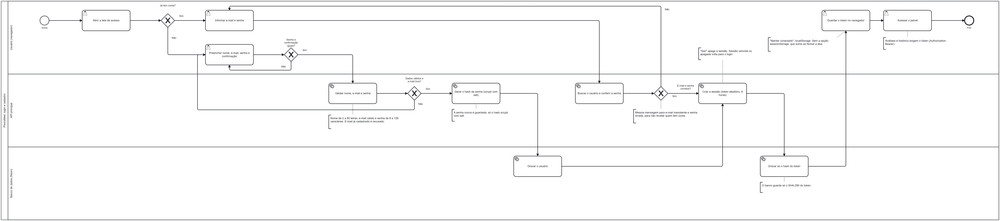
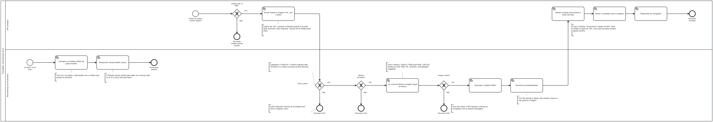

# PixoraMed

Classificação de imagens médicas de câncer com redes neurais em PyTorch, e um painel web para fazer previsões e comparar os resultados dos treinos.

O app cobre três tipos de câncer: Pele, Oral e Cérebro.

Projeto integrador do Bootcamp de IA (TCS / SENAI Londrina, 2026). Os notebooks de treino ficam no repositório **Projeto-ML-Cancer**. Este repositório tem o app que usa os modelos treinados lá.

> **Aviso:** ferramenta acadêmica. Não é um dispositivo médico e não faz diagnóstico.

## Workflows (BPMN 2.0)

Três processos, em `docs/bpmn/`. Os arquivos `.bpmn` seguem o padrão BPMN 2.0 e abrem em [bpmn.io](https://demo.bpmn.io) e no Camunda Modeler; também podem ser importados no Lucidchart. Os PNGs estão em alta resolução, para dar zoom.

### 1. Login e cadastro

Quem não tem conta se cadastra: a confirmação da senha é conferida no navegador, e a API valida os dados, recusa e-mail repetido e grava só o hash scrypt da senha. Quem tem conta informa e-mail e senha; erro de e-mail ou de senha recebe a mesma mensagem. Nos dois casos, a API cria uma sessão de 8 horas e o banco guarda só o hash do token.



Arquivo: [`docs/bpmn/1_login.bpmn`](docs/bpmn/1_login.bpmn)

### 2. Microsserviço de IA

Quando o container sobe, a IA carrega os modelos ONNX uma vez. A cada análise, a API principal confere o tamanho da imagem e envia a imagem à IA com o token. A IA confere o token, o modelo e a imagem, pré-processa como no treino, roda o modelo e devolve só as probabilidades. A API decide a classe e grava o resultado, sem a imagem.



Arquivo: [`docs/bpmn/2_microsservico_ia.bpmn`](docs/bpmn/2_microsservico_ia.bpmn)

### 3. Uso do sistema: análise de uma imagem

O usuário entra, escolhe o tipo de câncer, envia a imagem, confirma o consentimento e revisa o caso. A IA devolve as probabilidades, e o sistema decide: em Oral e Cérebro, "inconclusivo" abaixo de 80%; na Pele, maligno a partir de 18%, com aviso de baixa certeza. O resultado é gravado sem a imagem e exibido com os avisos.


Arquivo: [`docs/bpmn/3_uso_do_sistema.bpmn`](docs/bpmn/3_uso_do_sistema.bpmn)

Os três diagramas são gerados por `docs/bpmn/gerador/gerar.py`. Para mudar um processo, edite as etapas lá e rode `python gerar.py` dentro dessa pasta; depois exporte os PNGs de novo, por exemplo pelo bpmn.io.

## Arquitetura

```
Notebooks (PyTorch, GPU)
   │  torch.save(.pt)
   ▼
scripts/exportar_onnx.py ──► models/ (.onnx + .json)
                                 │
                                 ▼
                     Microsserviço de IA (ia/)          resultados.csv
                     ONNX Runtime, CPU                        │ Pandas
                     devolve probabilidades                   ▼
                                 ▲                   PostgreSQL / SQLite
                     HTTP + token│                            ▲
                                 │                            │
React + Vite (painel) ──/api──► API principal (backend/) ─────┘
                                 login, histórico, decisão da classe
```

A API principal não carrega modelos: ela confere o login, envia a imagem ao microsserviço de IA e decide a classe final (inconclusivo, limiar da Pele) com as probabilidades que voltam. O microsserviço de IA não acessa o banco nem guarda a imagem, e só aceita chamadas com o token `IA_TOKEN`, o mesmo nos dois serviços.

| Camada | Tecnologia | Onde roda |
|---|---|---|
| Frontend | React 19, Vite, TypeScript, Recharts, TanStack Query (CSS próprio, em `frontend/src/styles`) | Render, servido pela própria API |
| API principal | FastAPI, SQLAlchemy 2, httpx | Render (Docker, `backend/Dockerfile`) |
| Microsserviço de IA | FastAPI, ONNX Runtime, OpenCV, Pillow | Render (Docker, `ia/Dockerfile`) |
| Banco | PostgreSQL (SQLite no desenvolvimento) | Neon |
| Infra | Docker Compose (local), Terraform (nuvem) | `infra/terraform` |

O treino acontece em PyTorch na GPU. Para o app, cada modelo é exportado para **ONNX** e roda na CPU com o ONNX Runtime, sem precisar do PyTorch no servidor.

| Módulo | Modelo | Entrada | Saída | Arquivo |
|---|---|---|---|---|
| Oral | CNN pequena (~24 mil parâmetros) | 128×128, cor | `normal` ou `scc`, a classe mais provável | ~110 KB |
| Cérebro | CNN pequena (~24 mil parâmetros) | 128×128, cinza | `glioma`, `menin` ou `tumor`, a classe mais provável | ~110 KB |
| Pele | Ensemble de 5 EfficientNet-B0 com calibração de Platt | 224×224, cor, normalização ImageNet | `benigno` ou `maligno` (mel + bcc), com limiar de 18% | ~80 MB |

Em Oral e Cérebro, a API principal responde `inconclusivo` quando a confiança fica abaixo de 80% (variável `LIMIAR_INCONCLUSIVO`). A Pele mantém a classe do limiar próprio e, quando nenhuma classe chega a esse valor, a tela mostra um aviso de baixa certeza.

No microsserviço de IA, o ONNX Runtime usa 1 thread por padrão (variável `ONNX_THREADS`), porque criar uma thread por CPU visível deixa a inferência muito lenta em servidores com pouca CPU.

O modelo da Pele ainda não teve as métricas de teste registradas no app, e a queratose actínica (akiec) ficou fora do treino. Em Docker com 512 MB e 0,1 de CPU, como no plano gratuito do Render, o microsserviço de IA ficou em cerca de 250 MB com os três modelos, e a API principal em cerca de 110 MB.

## Estrutura

```
backend/             API principal
  app/
    main.py          API FastAPI (rotas /api/...) e o site React
    cliente_ia.py    chama o microsserviço de IA por HTTP
    decisao.py       classe final, inconclusivo e limiar da Pele
    autenticacao.py  senhas, sessões e a exigência de login
    importacao.py    resultados.csv -> banco SQL com Pandas
    tabelas.py       tabelas usuarios, sessoes, treinos e previsoes (SQLAlchemy)
    routers/         auth, treinos, modelos, previsoes
  scripts/
    exportar_onnx.py         .pt do notebook -> models/<id>.onnx + .json
    exportar_ensemble_pele.py   5 .pt do pacote da Pele -> models/pele_cor.onnx + .json
    importar_resultados.py   importa um resultados.csv para o banco
  tests/
ia/                  microsserviço de IA
  app/
    main.py          rotas /saude, /modelos e /prever
    inferencia.py    carrega os .onnx e repete o pré-processamento dos notebooks
  tests/
frontend/            React (página pública, login e cadastro, painel, análise, histórico, resultados, modelos, limitações)
models/              modelos ONNX carregados pelo microsserviço de IA
data/resultados.csv  resultados dos treinos (cópia do Projeto-ML-Cancer)
docs/                workflows BPMN (docs/bpmn), deck e como salvar o modelo nos notebooks
infra/terraform/     Neon + Render (API principal e microsserviço de IA)
docker-compose.yml
```

## Pré-requisitos

- Python 3.12 ou mais novo
- Node.js 22 ou mais novo
- Docker Desktop (opcional, para subir tudo junto)

## Rodando localmente

### Opção 1: Docker (tudo junto)

```bash
docker compose up --build
```

- App: http://localhost:8080
- Documentação da API principal: http://localhost:8000/docs
- Documentação do microsserviço de IA: http://localhost:8001/docs

### Opção 2: sem Docker (para desenvolver)

Microsserviço de IA, em um terminal (use o mesmo token nos dois serviços):

```bash
cd ia
python -m venv .venv
.venv\Scripts\activate        # Linux/Mac: source .venv/bin/activate
pip install -r requirements-dev.txt
set IA_TOKEN=token-local        # Linux/Mac: export IA_TOKEN=token-local
uvicorn app.main:app --reload --port 8001
```

API principal, em outro terminal:

```bash
cd backend
python -m venv .venv
.venv\Scripts\activate        # Linux/Mac: source .venv/bin/activate
pip install -r requirements-dev.txt
set IA_TOKEN=token-local        # Linux/Mac: export IA_TOKEN=token-local
uvicorn app.main:app --reload
```

Sem `DATABASE_URL`, a API usa SQLite em `data/pixoramed.db` e importa o `data/resultados.csv` ao iniciar. Sem `IA_URL`, procura a IA em `http://localhost:8001`.

Frontend, em outro terminal:

```bash
cd frontend
npm install
npm run dev
```

Abra http://localhost:5173. O Vite repassa `/api` para o backend na porta 8000.

### Testes

```bash
cd backend
pytest
cd ../ia
pytest
```

Os testes da API principal usam uma IA falsa; os do microsserviço de IA rodam os três modelos reais da pasta `models/`.

## Adicionando um modelo

1. No notebook do Projeto-ML-Cancer, rode a seção "Salvar o modelo final" (passo a passo em `docs/salvar_modelo.md`). Ela treina o modelo final e salva o `.pt`.
2. Converta para ONNX:
   ```bash
   cd backend
   pip install torch --index-url https://download.pytorch.org/whl/cpu
   python scripts/exportar_onnx.py "C:\caminho\para\Projeto-ML-Cancer\modelos_pt\oral_cor.pt"
   ```
3. Reinicie o microsserviço de IA. O modelo aparece em "Analisar imagem" em até 5 minutos, quando a API principal renova a lista.

O ensemble da Pele veio de um pacote à parte e usa outro script, que também precisa do `torchvision`:

```bash
cd backend
pip install torch torchvision --index-url https://download.pytorch.org/whl/cpu
python scripts/exportar_ensemble_pele.py "C:\caminho\para\HAM10000_PACOTE_INFERENCIA"
```

## Atualizando os resultados

Substitua `data/resultados.csv` pela versão nova (mesmo formato dos notebooks: `;`, vírgula decimal) e reinicie a API, ou rode:

```bash
cd backend
python scripts/importar_resultados.py ../data/resultados.csv
```

Só as execuções novas são inseridas (a chave é `data_hora` + `dataset`).

## API

| Método | Rota | O que faz |
|---|---|---|
| POST | `/api/auth/cadastro` | Cria a conta (`nome`, `email`, `senha`) e já devolve a sessão |
| POST | `/api/auth/login` | Entra com `email` e `senha` e devolve o token da sessão |
| GET | `/api/auth/eu` | Usuário da sessão atual (exige login) |
| POST | `/api/auth/sair` | Apaga a sessão no servidor (exige login) |
| GET | `/api/saude` | Status da API principal (não consulta a IA) |
| GET | `/api/treinos` | Treinos (filtros: `cancer`, `modo`, `normalizado`) |
| GET | `/api/treinos/canceres` | Tipos de câncer com treinos |
| GET | `/api/modelos` | Modelos disponíveis para previsão, vindos do microsserviço de IA |
| POST | `/api/previsoes` | Envia `modelo_id` + `arquivo` (imagem) e recebe a classe e as probabilidades (exige login) |
| GET | `/api/previsoes` | Histórico das últimas previsões do usuário logado (exige login) |

As rotas que exigem login recebem o cabeçalho `Authorization: Bearer <token>`. A senha é guardada só como hash scrypt com salt, e o banco guarda só o SHA-256 do token. A sessão vale por 8 horas (variável `SESSAO_HORAS`).

## Deploy na nuvem

Ver [infra/README.md](infra/README.md).

## Limitação técnica e trabalhos futuros

O protótipo não verifica se a imagem é compatível com o módulo escolhido. Ele foi pensado para uso por médicos, que escolhem o módulo e o exame corretos, então não há uma trava para esse caso. Uma imagem sem relação, como um fundo ou um exame de outro tipo, também recebe uma das classes do treino.

Como trabalho futuro, um filtro poderia recusar essas imagens antes da classificação, comparando-as com o padrão do treino ou usando um modelo que identifique o tipo de exame.

## Datasets e créditos

Os modelos foram treinados no repositório Projeto-ML-Cancer com dois datasets públicos do Kaggle. As imagens não ficam neste repositório.

### Multi Cancer Dataset

Usado em Oral e Cérebro. Crédito ao autor, **Obuli Sai Naren**, que pede a citação em pesquisas e projetos que usem o dataset:

> Obuli Sai Naren. (2022). *Multi Cancer Dataset* [Data set]. Kaggle. https://doi.org/10.34740/KAGGLE/DSV/3415848

- Página: https://www.kaggle.com/datasets/obulisainaren/multi-cancer
- Licença: [CC BY-NC-SA 4.0](https://creativecommons.org/licenses/by-nc-sa/4.0/)
- Fontes originais indicadas pelo autor, para as classes que usamos: dataset do Figshare (cérebro) e Ashenafi Fasil Kebede (oral).

### Skin Cancer MNIST: HAM10000

Usado em Pele. Publicado no Kaggle por K Scott Mader. Os autores do dataset são Tschandl, Rosendahl e Kittler:

> Tschandl, P., Rosendahl, C. & Kittler, H. (2018). The HAM10000 dataset, a large collection of multi-source dermatoscopic images of common pigmented skin lesions. *Scientific Data*, 5, 180161. https://doi.org/10.1038/sdata.2018.161

- Página: https://www.kaggle.com/datasets/kmader/skin-cancer-mnist-ham10000
- Licença: [CC BY-NC-SA 4.0](https://creativecommons.org/licenses/by-nc-sa/4.0/)

### Alterações e condições de uso

Reduzimos as imagens para 128×128 e, no Multi Cancer, usamos só uma parte das imagens de cada classe. As duas licenças exigem crédito, proíbem o uso comercial e pedem que material derivado seja compartilhado pela mesma licença.

## Privacidade

A imagem enviada é processada em memória e descartada. A tabela `previsoes` guarda só o modelo, a classe prevista, a confiança, o tempo, o horário e o usuário que fez a análise. Cada usuário vê só o próprio histórico.
