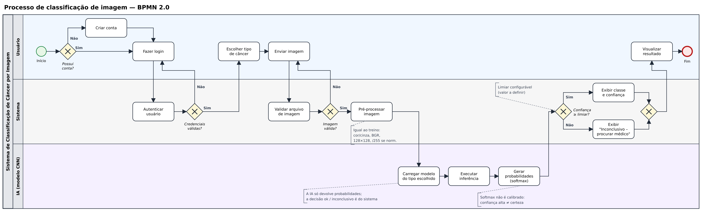

# PixoraMed

Classificação de imagens médicas de câncer com redes neurais em PyTorch, e um painel web para fazer previsões e comparar os resultados dos treinos.

O app cobre três tipos de câncer: Pele, Oral e Cérebro.

Projeto integrador do Bootcamp de IA (TCS / SENAI Londrina, 2026). Os notebooks de treino ficam no repositório **Projeto-ML-Cancer**. Este repositório tem o app que usa os modelos treinados lá.

> **Aviso:** ferramenta acadêmica. Não é um dispositivo médico e não faz diagnóstico.

## Processo (BPMN 2.0)



## Arquitetura

```
Notebooks (PyTorch, GPU)
   │  torch.save(.pt)          resultados.csv
   ▼                                │
scripts/exportar_onnx.py            │ Pandas
   │  .onnx + .json                 ▼
   ▼                         PostgreSQL / SQLite
models/ ──► FastAPI (ONNX Runtime, CPU) ◄──┘
                │  /api
                ▼
        React + Vite (painel)
```

| Camada | Tecnologia | Onde roda |
|---|---|---|
| Frontend | React 19, Vite, TypeScript, Recharts, TanStack Query (CSS próprio, em `frontend/src/styles`) | Render, servido pela própria API |
| API | FastAPI, ONNX Runtime, OpenCV, SQLAlchemy 2 | Render (Docker) |
| Banco | PostgreSQL (SQLite no desenvolvimento) | Neon |
| Infra | Docker Compose (local), Terraform (nuvem) | `infra/terraform` |

O treino acontece em PyTorch na GPU. Para o app, cada modelo é exportado para **ONNX** e roda na CPU com o ONNX Runtime, sem precisar do PyTorch no servidor.

| Módulo | Modelo | Entrada | Saída | Arquivo |
|---|---|---|---|---|
| Oral | CNN pequena (~24 mil parâmetros) | 128×128, cor | `normal` ou `scc`, a classe mais provável | ~110 KB |
| Cérebro | CNN pequena (~24 mil parâmetros) | 128×128, cinza | `glioma`, `menin` ou `tumor`, a classe mais provável | ~110 KB |
| Pele | Ensemble de 5 EfficientNet-B0 com calibração de Platt | 224×224, cor, normalização ImageNet | `benigno` ou `maligno` (mel + bcc), com limiar de 18% | ~80 MB |

Em Oral e Cérebro, a API responde `inconclusivo` quando a confiança fica abaixo de 80% (variável `LIMIAR_INCONCLUSIVO`). A Pele mantém a classe do limiar próprio e, quando nenhuma classe chega a esse valor, a tela mostra um aviso de baixa certeza.

O ONNX Runtime usa 1 thread por padrão (variável `ONNX_THREADS`), porque criar uma thread por CPU visível deixa a API muito lenta em servidores com pouca CPU.

O modelo da Pele ainda não teve as métricas de teste registradas no app, e a queratose actínica (akiec) ficou fora do treino. No Windows, com os três modelos, o pico de memória medido foi de 250 MB, sem incluir o restante da API. O uso nos 512 MB do plano gratuito do Render ainda não foi testado.

## Estrutura

```
backend/
  app/
    main.py          API FastAPI (rotas /api/...)
    inferencia.py    carrega os .onnx e repete o pré-processamento dos notebooks
    importacao.py    resultados.csv -> banco SQL com Pandas
    tabelas.py       tabelas treinos e previsoes (SQLAlchemy)
    routers/         treinos, modelos, previsoes
  scripts/
    exportar_onnx.py         .pt do notebook -> models/<id>.onnx + .json
    exportar_ensemble_pele.py   5 .pt do pacote da Pele -> models/pele_cor.onnx + .json
    importar_resultados.py   importa um resultados.csv para o banco
  tests/
frontend/            React (página pública, acesso simulado, painel, análise, histórico, resultados, modelos, limitações)
models/              modelos ONNX carregados pela API
data/resultados.csv  resultados dos treinos (cópia do Projeto-ML-Cancer)
docs/                como salvar o modelo nos notebooks
infra/terraform/     Neon + Render
docker-compose.yml
```

## Pré-requisitos

- Python 3.12 ou mais novo
- Node.js 22 ou mais novo
- Docker Desktop (opcional, para subir tudo junto)

## Rodando localmente

### Opção 1: Docker (tudo junto)

```bash
docker compose up --build
```

- App: http://localhost:8080
- Documentação da API: http://localhost:8000/docs

### Opção 2: sem Docker (para desenvolver)

Backend, em um terminal:

```bash
cd backend
python -m venv .venv
.venv\Scripts\activate        # Linux/Mac: source .venv/bin/activate
pip install -r requirements-dev.txt
uvicorn app.main:app --reload
```

Sem `DATABASE_URL`, a API usa SQLite em `data/pixoramed.db` e importa o `data/resultados.csv` ao iniciar.

Frontend, em outro terminal:

```bash
cd frontend
npm install
npm run dev
```

Abra http://localhost:5173. O Vite repassa `/api` para o backend na porta 8000.

### Testes

```bash
cd backend
pytest
```

## Adicionando um modelo

1. No notebook do Projeto-ML-Cancer, rode a seção "Salvar o modelo final" (passo a passo em `docs/salvar_modelo.md`). Ela treina o modelo final e salva o `.pt`.
2. Converta para ONNX:
   ```bash
   cd backend
   pip install torch --index-url https://download.pytorch.org/whl/cpu
   python scripts/exportar_onnx.py "C:\caminho\para\Projeto-ML-Cancer\modelos_pt\oral_cor.pt"
   ```
3. Reinicie a API. O modelo aparece em "Analisar imagem".

O ensemble da Pele veio de um pacote à parte e usa outro script, que também precisa do `torchvision`:

```bash
cd backend
pip install torch torchvision --index-url https://download.pytorch.org/whl/cpu
python scripts/exportar_ensemble_pele.py "C:\caminho\para\HAM10000_PACOTE_INFERENCIA"
```

## Atualizando os resultados

Substitua `data/resultados.csv` pela versão nova (mesmo formato dos notebooks: `;`, vírgula decimal) e reinicie a API, ou rode:

```bash
cd backend
python scripts/importar_resultados.py ../data/resultados.csv
```

Só as execuções novas são inseridas (a chave é `data_hora` + `dataset`).

## API

| Método | Rota | O que faz |
|---|---|---|
| GET | `/api/saude` | Status e número de modelos carregados |
| GET | `/api/treinos` | Treinos (filtros: `cancer`, `modo`, `normalizado`) |
| GET | `/api/treinos/canceres` | Tipos de câncer com treinos |
| GET | `/api/modelos` | Modelos disponíveis para previsão |
| POST | `/api/previsoes` | Envia `modelo_id` + `arquivo` (imagem) e recebe a classe e as probabilidades |
| GET | `/api/previsoes` | Histórico das últimas previsões |

## Deploy na nuvem

Ver [infra/README.md](infra/README.md).

## Limitação técnica e trabalhos futuros

O protótipo não verifica se a imagem é compatível com o módulo escolhido. Ele foi pensado para uso por médicos, que escolhem o módulo e o exame corretos, então não há uma trava para esse caso. Uma imagem sem relação, como um fundo ou um exame de outro tipo, também recebe uma das classes do treino.

Como trabalho futuro, um filtro poderia recusar essas imagens antes da classificação, comparando-as com o padrão do treino ou usando um modelo que identifique o tipo de exame.

## Datasets e créditos

Os modelos foram treinados no repositório Projeto-ML-Cancer com dois datasets públicos do Kaggle. As imagens não ficam neste repositório.

### Multi Cancer Dataset

Usado em Oral e Cérebro. Crédito ao autor, **Obuli Sai Naren**, que pede a citação em pesquisas e projetos que usem o dataset:

> Obuli Sai Naren. (2022). *Multi Cancer Dataset* [Data set]. Kaggle. https://doi.org/10.34740/KAGGLE/DSV/3415848

- Página: https://www.kaggle.com/datasets/obulisainaren/multi-cancer
- Licença: [CC BY-NC-SA 4.0](https://creativecommons.org/licenses/by-nc-sa/4.0/)
- Fontes originais indicadas pelo autor, para as classes que usamos: dataset do Figshare (cérebro) e Ashenafi Fasil Kebede (oral).

### Skin Cancer MNIST: HAM10000

Usado em Pele. Publicado no Kaggle por K Scott Mader. Os autores do dataset são Tschandl, Rosendahl e Kittler:

> Tschandl, P., Rosendahl, C. & Kittler, H. (2018). The HAM10000 dataset, a large collection of multi-source dermatoscopic images of common pigmented skin lesions. *Scientific Data*, 5, 180161. https://doi.org/10.1038/sdata.2018.161

- Página: https://www.kaggle.com/datasets/kmader/skin-cancer-mnist-ham10000
- Licença: [CC BY-NC-SA 4.0](https://creativecommons.org/licenses/by-nc-sa/4.0/)

### Alterações e condições de uso

Reduzimos as imagens para 128×128 e, no Multi Cancer, usamos só uma parte das imagens de cada classe. As duas licenças exigem crédito, proíbem o uso comercial e pedem que material derivado seja compartilhado pela mesma licença.

## Privacidade

A imagem enviada é processada em memória e descartada. A tabela `previsoes` guarda só o modelo, a classe prevista, a confiança, o tempo e o horário.
