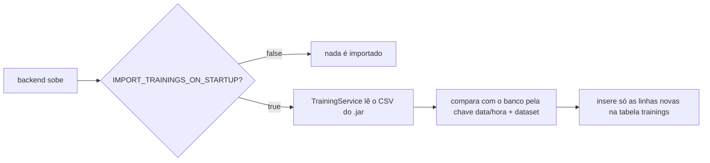

# backend

API do PixoraMed em **Java 21 + Spring Boot 4**. Faz o login (JWT), guarda o histórico das análises, importa os resultados dos treinos e decide a classe final com as probabilidades que vêm do ai-service. Não serve o site: o frontend fica na Vercel.

## Camadas

```
controller  → recebe o HTTP, valida o DTO e chama o service (sem regra de negócio)
service     → regras de negócio (login, decisão da classe, importação do CSV, cliente do ai-service)
repository  → acesso ao banco (Spring Data JPA)
model       → entidades JPA (tabelas users, trainings, predictions)
dto         → formatos de entrada e saída da API (a entidade nunca sai direto na resposta)
security    → SecurityConfig (rotas públicas, JWT, CORS, BCrypt) e TokenService (gera o JWT)
exception   → ApiException e GlobalExceptionHandler (todo erro sai como {"message": "..."})
```

## Rotas

| Método | Rota | Login? | O que faz |
|---|---|---|---|
| POST | `/api/auth/register` | não | Cria a conta (`name`, `email`, `password`) e devolve `{token, expiresAt, user}` |
| POST | `/api/auth/login` | não | Entra com `email` e `password` e devolve `{token, expiresAt, user}` |
| GET | `/api/health` | não | Status da API (usado pelo Render; não consulta a IA) |
| GET | `/api/trainings` | não | Treinos importados do CSV |
| GET | `/api/models` | não | Modelos do ai-service, com os limiares de decisão |
| POST | `/api/predictions` | sim | Envia `modelId` + `file` (multipart) e recebe a classe e as probabilidades |
| GET | `/api/predictions?limit=100` | sim | Histórico do usuário logado |

As rotas com login recebem `Authorization: Bearer <token>`. O token é um JWT assinado com `JWT_SECRET` (HS256) e vale `JWT_EXPIRATION_HOURS` horas. A senha fica só como hash BCrypt. Não há rota de logout: o JWT não fica no banco, então o site só apaga o token.

## Log

O backend registra no console (no Render, aba Logs do serviço) os cadastros, os logins aceitos e recusados e cada análise, concluída ou não. O usuário aparece só pelo id: e-mail, senha, token e imagem nunca vão para o log. A lista completa de eventos está na skill `backend-architecture`.

Exemplo (Docker local):

```
INFO  AuthService       : Login do usuário 4
WARN  AuthService       : Login recusado: senha incorreta para o usuário 4
WARN  AuthService       : Login recusado: e-mail não cadastrado
INFO  PredictionService : Análise 17 concluída: usuário 5, modelo skin_color, classe malignant, confiança 0.7947, IA em 147 ms
WARN  PredictionService : Análise não concluída: usuário 4, modelo oral_color, status 422
```

## Configuração

Tudo vem de variáveis de ambiente (`src/main/resources/application.properties` usa `${VAR}`). No desenvolvimento, o Spring lê também o `backend/.env`. Variável obrigatória que faltar impede a aplicação de subir. Lista completa, com explicação, em [`.env.example`](.env.example).

| Variável | Obrigatória | Para quê |
|---|---|---|
| `DATABASE_URL`, `DATABASE_USERNAME`, `DATABASE_PASSWORD` | sim | PostgreSQL (JDBC) |
| `JWT_SECRET` | sim | Assina o token de login (mínimo 32 caracteres) |
| `CORS_ALLOWED_ORIGINS` | sim | Endereço do site |
| `AI_SERVICE_URL`, `AI_SERVICE_TOKEN` | sim | Onde está o ai-service e o token interno (igual nos dois) |
| `JWT_EXPIRATION_HOURS`, `AI_SERVICE_TIMEOUT_SECONDS`, `INCONCLUSIVE_THRESHOLD`, `IMPORT_TRAININGS_ON_STARTUP` | não | Têm valor padrão |

## Banco e a pasta `data`

O banco é simples, sem migrations: o Hibernate cria e atualiza as tabelas sozinho (`spring.jpa.hibernate.ddl-auto=update`).

| Tabela | Conteúdo |
|---|---|
| `users` | nome, e-mail (único) e hash BCrypt da senha |
| `trainings` | uma linha por treino do `training-results.csv` |
| `predictions` | uma linha por análise: usuário, modelo, classe, confiança, probabilidade de cada classe (JSON), tempo e horário (sem imagem) |

### Como a pasta `data` popula o banco

O arquivo `src/main/resources/data/training-results.csv` é a tabela de treinos gerada pelos notebooks do Projeto-ML-Cancer (separador `;` e vírgula decimal). Ele entra no `.jar` e é importado **toda vez que o backend sobe**:



- **Mecanismo:** `TrainingService.importOnStartup()`, chamado pelo evento `ApplicationReadyEvent` do Spring.
- **Idempotente:** pode rodar quantas vezes quiser; linhas que já estão no banco são ignoradas e nada é apagado.
- **Ambientes:** roda no local e na produção. Para atualizar os treinos, substitua o CSV, faça commit e o próximo deploy importa as linhas novas.
- **Do zero no local:** `docker compose down -v` (na pasta `infra/`) apaga o volume do Postgres; o próximo `up` recria as tabelas e importa o CSV de novo. Isso não afeta o Neon.
- Não há seed de usuários nem dados pessoais: cada pessoa cria a conta pela tela de cadastro.

## Rodando sem Docker

Precisa de Java 21, Maven e um PostgreSQL (pode ser o do compose: `docker compose up db` na pasta `infra/`).

```bash
cd backend
copy .env.example .env      # Linux/Mac: cp .env.example .env  (e preencha)
mvn spring-boot:run
```

## Testes

```bash
mvn test
```

Testam a regra de decisão (`DecisionServiceTest`) e a leitura do CSV real (`TrainingServiceTest`), sem precisar de banco.

## Docker

O `Dockerfile` é multi-stage: compila com Maven + JDK 21 e roda o `.jar` só com o JRE, como usuário sem privilégios e com a memória limitada a 70% do container (o Render gratuito tem 512 MB).
