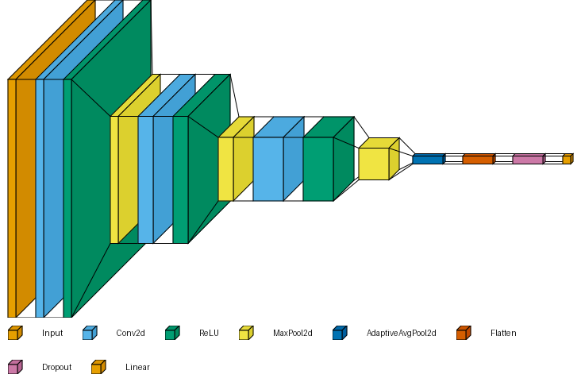
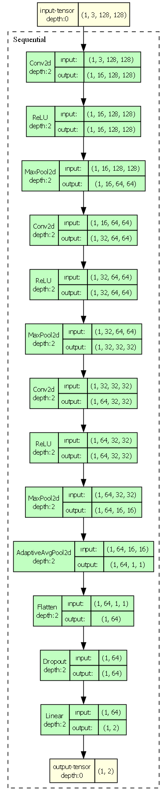
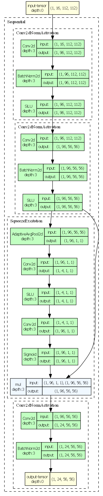
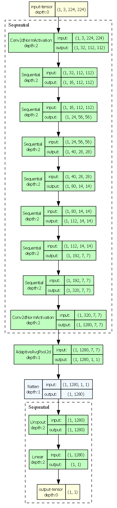
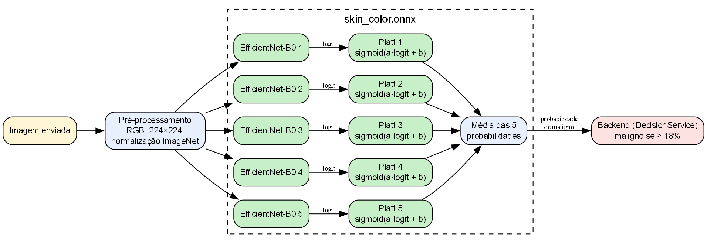

# Guia de estudo — conceitos do PixoraMed

Nov 12, 2026 · Grupo PixoraMed (Bootcamp de IA II/2026, TCS e SENAI Londrina)

## Como usar o guia

Cada conceito segue o mesmo roteiro, que é a ordem em que a banca costuma perguntar:

1. **O que é**: a definição em uma ou duas frases.
2. **Como funciona**: o mecanismo, sem jargão a mais.
3. **Onde está no código**: arquivo e trecho real do sistema.
4. **Por que o sistema usa**: o problema que ele resolve aqui.
5. **Pergunta de banca**: uma pergunta provável e a resposta curta.

A dica para a banca é responder nessa mesma ordem: definição, mecanismo, exemplo do próprio código, motivo.

Os números deste guia são os medidos pelo grupo. Regra de ouro na banca: **não arredondar para cima e não chamar teste da mesma fonte de "teste externo"**. A seção [Resultados e honestidade](#resultados-e-honestidade) diz o que cada número mede e o que não mede, e a seção [Métricas e conceitos de IA](#métricas-e-conceitos-de-ia) traz a definição, a fórmula e as perguntas de banca de cada termo (acurácia, F1, matriz de confusão, AUC, overfitting, viés, alucinação...). A seção [IA: os modelos](#ia-os-modelos) tem imagens das redes, geradas com Python.

## Visão geral em uma tela

**O que o sistema faz.** Classifica imagens de três tipos de câncer (Pele, Oral e Cérebro), mostra a classe prevista com a probabilidade de cada classe e guarda o histórico de cada usuário, com um resumo dos resultados. Também mostra os modelos e as limitações de cada um. As telas são pensadas para um médico: só o essencial, sem métricas técnicas de treino. É um protótipo acadêmico: não faz diagnóstico.

**Como a requisição anda.**

```
Navegador ──► frontend (React + Vite, Vercel)
                 │  /api/*  (rewrite do vercel.json)
                 ▼
              backend (Spring Boot, Render) ──SQL──► PostgreSQL (Neon)
                 │  HTTP + header X-Internal-Token
                 ▼
              ai-service (FastAPI + ONNX Runtime, Render)
```

| Serviço   | Faz                                                                                | Não faz                                            |
| ---------- | ---------------------------------------------------------------------------------- | --------------------------------------------------- |
| frontend   | Mostra as telas e chama `/api`                                                   | Regra de negócio, guardar segredo                  |
| backend    | Login (JWT), histórico, importação dos treinos, **decide a classe final** | Rodar o modelo                                      |
| ai-service | Pré-processa a imagem, roda o modelo, devolve probabilidades                      | Acessar o banco, guardar a imagem, decidir a classe |

**Pergunta de banca.** *Resuma a arquitetura em 30 segundos.* Resposta: "São três serviços. O React na Vercel só mostra as telas e chama `/api`. A Vercel repassa para o backend Spring Boot no Render, que cuida do login, do histórico e da regra de decisão, e grava no PostgreSQL do Neon. Para classificar a imagem, o backend chama o ai-service em Python, que roda os modelos ONNX e devolve só as probabilidades. A IA não tem banco e não guarda imagem."

## Estrutura do projeto

### Monorepo com uma pasta por serviço

**O que é.** Um único repositório Git com os três serviços e a infraestrutura, cada um na sua pasta, com Dockerfile, README, `.env.example` e documentação própria.

```
backend/      API Spring Boot (controller, service, repository, model, dto, security, exception)
frontend/     site React (api, auth, context, hooks, components, pages, utils, styles)
ai-service/   microsserviço de IA: app/, models/ (ONNX), scripts/ (exportação), tests/
infra/        docker-compose.yml (local) e terraform/ (nuvem)
docs/         BPMN, documento de entrega, glossário, guia para salvar modelos e este guia
```

**Por que o sistema usa.** O grupo é pequeno e as três partes mudam juntas: quando a IA passa a devolver um campo novo, o backend e a tela mudam no mesmo commit. Num repositório só, um `git log` conta a história inteira e a banca recebe um único link. Mesmo assim, os serviços são **independentes**: nenhum importa código do outro, cada um tem a sua imagem Docker e o seu deploy.

**Pergunta de banca.** *Por que não um repositório por serviço?* Resposta: "Com três serviços e quatro pessoas, separar só aumentaria o trabalho de manter versões alinhadas. A separação que importa existe: cada pasta tem build, Dockerfile e deploy próprios, e eles só se falam por HTTP."

### Por que a IA é um microsserviço separado

**O que é.** O código que roda os modelos fica num serviço próprio, em Python, chamado pelo backend.

**Por que o sistema usa.**

- **Linguagem certa para cada parte**: os modelos foram treinados em Python (PyTorch), e as bibliotecas de imagem (OpenCV, Pillow) e o ONNX Runtime são do mundo Python. O backend fica em Java, que é o padrão de mercado para API com login e banco.
- **Peso**: OpenCV e ONNX Runtime são quase toda a imagem do ai-service (~862 MB). O backend não carrega isso.
- **Isolamento**: a IA não tem acesso a nenhum dado de usuário. Recebe uma imagem, devolve números.
- **Troca de modelo sem mexer no resto**: um modelo novo é um par `.onnx` + `.json` na pasta `models/`.

**Pergunta de banca.** *Por que não rodar o modelo direto no Java?* Resposta: "Daria para rodar ONNX em Java, mas o pré-processamento precisa ser idêntico ao do treino, que foi feito em Python com OpenCV e PIL. Uma diferença de cor ou de redimensionamento derruba a acurácia. Manter a inferência em Python garante a mesma conta do notebook."

### Por que a regra de decisão fica no backend

**O que é.** A IA devolve só probabilidades. Quem decide se o resultado é "maligno", "benigno" ou "inconclusivo" é o `DecisionService` do backend.

**Por que o sistema usa.** Limiar é regra de negócio: muda mais do que o modelo e precisa de teste. No backend, ela é configurável por variável de ambiente (`INCONCLUSIVE_THRESHOLD`) e coberta pelo `DecisionServiceTest`. O frontend não decide nada, então ninguém muda a regra editando o JavaScript no navegador.

## Backend: Java e Spring Boot

### Camadas (Controller, Service, Repository, Model)

**O que é.** Cada camada tem uma responsabilidade:

| Camada     | Faz                                                                               | Não faz          |
| ---------- | --------------------------------------------------------------------------------- | ----------------- |
| Controller | Recebe o HTTP, valida o DTO (`@Valid`), devolve o status                        | Regra de negócio |
| Service    | Regras de negócio: login, decisão da classe, importação do CSV, chamada à IA | Conhecer HTTP     |
| Repository | Acesso ao banco (Spring Data JPA)                                                 | Decidir regra     |
| Model      | Entidades JPA (`User`, `Training`, `Prediction`): cada classe com `@Entity` vira uma tabela (`users`, `trainings`, `predictions`) e cada campo vira uma coluna | Sair direto na resposta da API (quem sai é o DTO) |

Além delas: `dto` (entrada e saída da API), `security` (JWT, BCrypt, CORS) e `exception` (erros padronizados).

**Como as camadas se encaixam numa análise:** o `PredictionController` recebe o `POST`, o `PredictionService` chama a IA e decide a classe, cria um objeto `Prediction` (o **model**) com o resultado, e o `PredictionRepository` grava esse objeto na tabela `predictions`. Na volta, o service converte o model num DTO (`PredictionResponse`), que é o que o navegador recebe.

**Onde está no código.** `PredictionController` só lê o usuário do token e repassa:

```java
public PredictionResponse predict(@AuthenticationPrincipal Jwt jwt, ...) {
    return predictionService.predict(Long.valueOf(jwt.getSubject()), modelId, file);
}
```

**Por que o sistema usa.** Uma regra fica num só lugar. A regra "cada usuário vê só as próprias análises" está no `PredictionService.history`, e nenhum controller precisa repeti-la.

### Métodos HTTP e as rotas do sistema

**O que é.** Toda requisição HTTP tem um **método** (também chamado de verbo), que diz o que o cliente quer fazer com o recurso da URL. Os principais:

| Método | Para quê | Seguro? (não altera nada) | Idempotente? (repetir dá o mesmo efeito) |
| --- | --- | --- | --- |
| `GET` | Ler um recurso | Sim | Sim |
| `POST` | Criar algo ou enviar dados para processar | Não | Não |
| `PUT` | Substituir um recurso inteiro | Não | Sim |
| `PATCH` | Alterar parte de um recurso | Não | Não necessariamente |
| `DELETE` | Apagar um recurso | Não | Sim |
| `OPTIONS` | Perguntar o que o servidor aceita (o navegador usa no *preflight* do CORS) | Sim | Sim |

**Como funciona.** O método vem na primeira linha da requisição, junto com a URL (`POST /api/predictions HTTP/1.1`). No Spring, cada método do controller é ligado a um verbo por uma anotação: `@GetMapping`, `@PostMapping` (e existem `@PutMapping`, `@PatchMapping` e `@DeleteMapping`). No FastAPI, pelo decorador: `@app.get`, `@app.post`. A resposta volta com um **código de status**: `200` (ok), `201` (criado), `401` (sem login válido), `404` (não encontrado), `409` (conflito), `413` (arquivo grande), `422` (dados inválidos), `503` (serviço indisponível).

**Onde está no código.** O PixoraMed usa **só `GET` e `POST`**:

| Método | Rota | Login? | O que faz | Onde |
| --- | --- | --- | --- | --- |
| `POST` | `/api/auth/register` | não | Cria a conta; responde **201** (ou 409 se o e-mail já existe) | `AuthController` |
| `POST` | `/api/auth/login` | não | Confere e-mail e senha e devolve o token JWT | `AuthController` |
| `GET` | `/api/health` | não | Diz se a API está no ar (usado pelo Render) | `TrainingController` |
| `GET` | `/api/trainings` | não | Lista os treinos importados do CSV | `TrainingController` |
| `GET` | `/api/models` | não | Lista os modelos da IA, com os limiares | `PredictionController` |
| `POST` | `/api/predictions` | sim | Envia a imagem (multipart) e recebe a classe e as probabilidades | `PredictionController` |
| `GET` | `/api/predictions?limit=100` | sim | Histórico do usuário logado | `PredictionController` |

Entre o backend e o ai-service, o padrão é o mesmo:

| Método | Rota | Token interno? | O que faz |
| --- | --- | --- | --- |
| `GET` | `/health` | não | Diz se a IA está no ar e quantos modelos carregou |
| `GET` | `/models` | sim | Lista os modelos carregados |
| `POST` | `/predict` | sim | Recebe a imagem e devolve as probabilidades |

```java
// AuthController: o cadastro cria um recurso, então responde 201 em vez de 200
@PostMapping("/register")
@ResponseStatus(HttpStatus.CREATED)
public AuthResponse register(@Valid @RequestBody RegisterRequest request) { ... }
```

O CORS do backend também libera só esses dois métodos: `config.setAllowedMethods(List.of("GET", "POST"))`. O `OPTIONS` do *preflight* o próprio Spring responde.

**Por que o sistema usa só esses dois.**

- **`GET` para tudo que só lê** (saúde, modelos, treinos, histórico): não altera nada, pode ser repetido sem efeito colateral e pode ser guardado em cache pelo navegador ou pelo TanStack Query.
- **`POST` para o que cria ou processa**: o cadastro cria um usuário, o login cria um token e a análise cria um registro no histórico. Mandar a mesma imagem duas vezes gera duas análises, então não é idempotente, e é exatamente o caso do `POST`.
- **Sem `PUT`, `PATCH` e `DELETE`** porque o sistema não tem nada para editar nem apagar: o histórico é um registro do que foi feito, a conta não tem tela de edição e o logout não precisa de rota (o site só apaga o token, porque o JWT não fica no banco). Criar rotas sem uso só aumentaria o que precisa ser protegido.

**Pergunta de banca.** *Por que o login é `POST` e não `GET`, se ele "busca" o usuário?* Resposta: "No `GET`, os dados vão na URL, e a URL fica no histórico do navegador e nos logs dos servidores. A senha nunca pode ir na URL. No `POST`, ela vai no corpo da requisição, protegido pelo HTTPS. Além disso, o login cria algo novo: o token."

**Pergunta de banca.** *Qual a diferença entre `PUT` e `PATCH`?* Resposta: "O `PUT` substitui o recurso inteiro; o `PATCH` altera só os campos enviados. O PixoraMed não usa nenhum dos dois, porque não tem edição de dados. Se um dia tiver a tela 'editar meu nome', o certo seria um `PATCH /api/users/me`."

**Pergunta de banca.** *O que é idempotente?* Resposta: "Repetir a requisição várias vezes deixa o servidor no mesmo estado que uma vez só. O `GET` do histórico é idempotente; o `POST` da análise não, porque cada envio grava uma análise nova."

### DTO e record

**O que é.** DTO (*Data Transfer Object*) é o objeto que entra ou sai da API, separado da entidade do banco. No PixoraMed os DTOs são `record`: classes imutáveis só de dados, em que o Java gera construtor, getters, `equals` e `toString`.

**Onde está no código.** A pasta `dto`: `RegisterRequest`, `LoginRequest`, `AuthResponse`, `PredictionResponse`, `UserResponse`... O `UserResponse.from(user)` monta a resposta a partir da entidade.

**Por que o sistema usa.** A entidade `User` tem o hash da senha; o `UserResponse` não tem. A entidade nunca sai direto na resposta. Os DTOs `AiModel` e `AiPrediction` também traduzem o JSON da IA, que vem em `snake_case` (`model_id`), para o padrão Java (`modelId`) com `@JsonAlias`.

**Pergunta de banca.** *Por que não devolver a entidade direto?* Resposta: "Ela tem campos que não podem sair, como o hash da senha, e acoplaria a API à estrutura do banco. O DTO define exatamente o contrato."

### Stream, lambda e Optional

**O que é.** *Stream* processa uma coleção em etapas encadeadas (`filter`, `map`, `sorted`) e só executa na operação terminal (`toList`, `collect`). *Lambda* é uma função sem nome (`m -> m.id()`), e *method reference* é o atalho para uma lambda que só chama um método (`AiModel::cancerType`). *Optional* é uma caixa que pode estar vazia, no lugar do `null`.

**Onde está no código.**

```java
// PredictionService.listModels: ordena os modelos da IA e converte para o DTO da API
return aiService.listModels().stream()
        .sorted(Comparator.comparing(AiModel::cancerType).thenComparing(AiModel::mode))
        .map(m -> new ModelResponse(m.id(), m.cancerType(), ...))
        .toList();

// TrainingService.importCsv: chaves dos treinos que já estão no banco
Set<String> existing = trainings.findAll().stream()
        .map(t -> t.getRunAt() + "|" + t.getDataset())
        .collect(Collectors.toSet());

// AuthService.login: o repositório devolve Optional<User>
User user = users.findByEmail(email).orElse(null);
```

**Por que o sistema usa.** Cada regra vira uma linha que diz *o que* se quer, sem índice nem variável auxiliar. O Optional obriga a tratar "não encontrei" no ponto da busca, e no login esse caso vira 401 com a mensagem genérica.

**Pergunta de banca.** *Por que Stream e não for?* Resposta: "O resultado é o mesmo. O Stream deixa a intenção explícita, não altera a lista original e evita variáveis de controle. No `DecisionService` mantive um `for`, porque ali preciso do índice da maior probabilidade."

### Tratamento global de erros

**O que é.** O `GlobalExceptionHandler`, com `@RestControllerAdvice`, converte cada exceção numa resposta JSON `{"message": "..."}` com o status certo.

| Exceção                                  | Status                                                     |
| ------------------------------------------ | ---------------------------------------------------------- |
| `ApiException` (lançada pelos services) | o status que ela carrega: 401, 404, 409, 413, 422, 503     |
| Erro de `@Valid` no DTO                  | 400, com a mensagem do primeiro campo inválido            |
| Imagem maior que 10 MB                     | 413                                                        |
| Qualquer outra                             | 500 "Erro interno", e o rastro da pilha vai só para o log |

**Por que o sistema usa.** Nenhum controller tem `try/catch`, e o frontend sempre recebe o mesmo formato de erro para mostrar ao usuário. Detalhe interno nunca sai na resposta.

## Backend: banco e dados

### JPA, Hibernate e as três tabelas

**O que é.** JPA é a especificação Java de mapeamento objeto-relacional (ORM); Hibernate é a implementação; Spring Data JPA gera os repositórios a partir do nome do método.

**Como funciona.** A classe `Prediction` com `@Entity` vira a tabela `predictions`. O método `findByUserIdOrderByCreatedAtDesc(userId, pageable)` vira `SELECT ... WHERE user_id = ? ORDER BY created_at DESC LIMIT ?`, sem SQL escrito à mão.

| Tabela          | Conteúdo                                                                      |
| --------------- | ------------------------------------------------------------------------------ |
| `users`       | nome, e-mail (único) e hash BCrypt da senha                                   |
| `trainings`   | uma linha por treino do `training-results.csv`                               |
| `predictions` | usuário, modelo, classe, confiança, probabilidade de cada classe (JSON), tempo e horário. **Sem a imagem** |

A tabela `predictions` tem índice em `userId`, que é a busca do histórico.

**Por que sem Flyway.** O `ddl-auto=update` deixa o Hibernate criar e atualizar as tabelas sozinho. Foi uma escolha de simplicidade do grupo: três tabelas, sem histórico de migrations para manter. Em um sistema com dados reais de produção, o caminho seria Flyway, para versionar cada mudança do banco.

**Pergunta de banca.** *Onde está o SQL do projeto?* Resposta: "O banco é PostgreSQL. As consultas são geradas pelo Spring Data JPA a partir dos métodos do repositório, como o histórico ordenado por data com limite de 100. As tabelas podem ser consultadas direto com SQL pelo pgAdmin, no banco local do Docker, na porta definida no `infra/.env`."

### Como os treinos entram no banco (Python, Pandas e o CSV)

**O que é.** Os notebooks de treino geram uma tabela de resultados (`training-results.csv`, 29 execuções). O backend importa essa tabela para a tabela `trainings` toda vez que sobe.

**Como funciona.**

1. Nos notebooks (repositório Projeto-ML-Cancer), Python treina e avalia com validação cruzada e grava uma linha por execução no CSV (separador `;` e vírgula decimal). O Pandas lê os metadados do HAM10000 no notebook da Pele.
2. O CSV vai para `backend/src/main/resources/data/` e entra no `.jar`.
3. No evento `ApplicationReadyEvent`, o `TrainingService.importOnStartup` lê o CSV, traduz os nomes ("Pele" → `skin`, "cinza" → `gray`) e insere **só as linhas novas**, comparando pela chave data/hora + dataset.

**Por que o sistema usa.** A importação é idempotente: pode rodar quantas vezes quiser sem duplicar. Atualizar os treinos é trocar o CSV e fazer deploy.

**Pergunta de banca.** *Onde o Pandas entra no projeto?* Resposta: "Na preparação dos dados e na análise dos treinos, nos notebooks. O sistema em produção não precisa do Pandas: ele só lê o CSV que os notebooks geraram."

## Backend: segurança

### Caminho de uma requisição autenticada

Antes de chegar ao Controller, toda requisição passa pela cadeia de filtros do Spring Security:

1. **CORS**: confere se a origem está em `CORS_ALLOWED_ORIGINS`.
2. **Regras de URL**: cadastro, login, `/health`, `/trainings` e `/models` são públicos; o resto exige token.
3. **Validação do JWT** (`oauth2ResourceServer().jwt()`): confere assinatura e validade do header `Authorization: Bearer`.
4. **Controller**: lê o id do usuário com `@AuthenticationPrincipal Jwt`.

```java
.authorizeHttpRequests(auth -> auth
        .requestMatchers(HttpMethod.POST, "/api/auth/register", "/api/auth/login").permitAll()
        .requestMatchers(HttpMethod.GET, "/api/health", "/api/trainings", "/api/models").permitAll()
        .anyRequest().authenticated())
.oauth2ResourceServer(oauth -> oauth.jwt(Customizer.withDefaults()));
```

### JWT (stateless)

**O que é.** JSON Web Token: um texto em três partes (cabeçalho, conteúdo, assinatura) assinado com o `JWT_SECRET`. Mudar qualquer letra do conteúdo invalida a assinatura.

**Como funciona.** No login, o `TokenService` gera um token HS256 com o id do usuário no `subject` e validade de 8 horas (`JWT_EXPIRATION_HOURS`). Em cada requisição o Spring confere a assinatura. *Stateless*: o servidor não guarda sessão; a prova de identidade vem no próprio token (`SessionCreationPolicy.STATELESS`).

```java
JwtClaimsSet claims = JwtClaimsSet.builder()
        .subject(user.getId().toString())
        .issuedAt(now)
        .expiresAt(expiresAt)
        .build();
```

O backend **não sobe** se o `JWT_SECRET` tiver menos de 32 caracteres, porque o HS256 exige chave de 256 bits.

**Por que o sistema usa.** O Render gratuito dorme e reinicia; como não há sessão na memória, ninguém perde o login quando o backend acorda.

**Pergunta de banca.** *Como funciona o logout se o token não fica no banco?* Resposta: "O site apaga o token do navegador. O token em si continua válido até vencer, em no máximo 8 horas. Revogar tokens antes do vencimento ficou como trabalho futuro."

### Onde o token fica no navegador

**Como funciona.** O `AuthContext` guarda a sessão no `sessionStorage`, que some ao fechar a aba. Com "Manter conectado", guarda no `localStorage`. O `apiClient` coloca o token no header `Authorization` de toda chamada, e uma resposta 401 faz logout com o aviso de sessão vencida.

**Pergunta de banca.** *Token no localStorage não é inseguro?* Resposta: "É a troca conhecida: um script malicioso na página (XSS) conseguiria ler o token. Reduzimos o risco porque o React escapa todo texto exibido e o token vence em 8 horas. A evolução seria um cookie `HttpOnly`, que o JavaScript não lê, como fizemos em outro projeto."

### BCrypt e a mensagem genérica de login

**O que é.** BCrypt é uma função de hash para senhas, com *salt* próprio por senha e cálculo lento de propósito.

**Onde está no código.** `SecurityConfig.passwordEncoder()` e `AuthService`. O cadastro grava `passwordEncoder.encode(senha)`; o login compara com `passwordEncoder.matches`.

**Por que o sistema usa.** Se o banco vazar, as senhas não aparecem, e o cálculo lento encarece tentar milhões de senhas. E-mail inexistente e senha errada recebem **a mesma resposta** ("E-mail ou senha incorretos."), para ninguém descobrir quem tem conta.

### Token interno entre backend e IA (X-Internal-Token)

**O que é.** Um segredo compartilhado (`AI_SERVICE_TOKEN`) que o backend envia em todo pedido à IA.

**Como funciona.** O ai-service compara o header com o token configurado usando `hmac.compare_digest`, que leva o mesmo tempo acertando ou errando:

```python
def require_token(x_internal_token: str = Header(default="")) -> None:
    if not hmac.compare_digest(x_internal_token.encode(), settings.ai_service_token.encode()):
        raise HTTPException(status_code=401, detail="Token do serviço de IA ausente ou inválido.")
```

Só o `/health` é público, porque o Render precisa dele para saber se o serviço está no ar. O token é obrigatório: sem ele, o ai-service não sobe.

**Por que o sistema usa.** No Render, a URL da IA é pública. Sem o token, qualquer pessoa usaria o modelo de graça, consumindo a CPU do plano gratuito.

**Pergunta de banca.** *Por que `compare_digest` e não `==`?* Resposta: "O `==` para no primeiro caractere diferente, e o tempo de resposta revelaria quantos caracteres estão certos. O `compare_digest` leva sempre o mesmo tempo."

### CORS e CSRF

**CORS.** Regra do navegador: um site só lê a resposta de outra origem se ela permitir. O backend libera só a origem do `CORS_ALLOWED_ORIGINS`, com os métodos GET e POST e os headers `Authorization` e `Content-Type`. Em produção o rewrite da Vercel deixa site e API no mesmo domínio.

**CSRF desligado.** O ataque CSRF depende de o navegador enviar a credencial sozinho, como faz com cookies. No PixoraMed o token vai no header `Authorization`, que o navegador nunca envia sozinho, então a proteção CSRF do Spring não tem o que proteger.

## Backend: configuração e operação

### Variáveis de ambiente e os arquivos .env

**O que é.** Tudo que muda entre máquinas (senha do banco, `JWT_SECRET`, token da IA, endereço do site) fica fora do código. O `application.properties` só referencia: `spring.datasource.url=${DATABASE_URL}`. Variável obrigatória que faltar impede o backend de subir.

**São três ambientes, e cada um lê os próprios arquivos:**

| Ambiente         | Como sobe                              | De onde vêm as variáveis                               |
| ---------------- | -------------------------------------- | -------------------------------------------------------- |
| Local com Docker | `docker compose up` em `infra/`    | só do `infra/.env`                                    |
| Local sem Docker | IntelliJ, `uvicorn`, `npm run dev` | `backend/.env`, `ai-service/.env`, `frontend/.env` |
| Produção       | Terraform cria; Render e Vercel rodam  | env groups do Render, preenchidos pelo Terraform         |

- **`infra/.env`**: o compose lê e distribui para cada container. A `POSTGRES_PASSWORD` vira o `DATABASE_PASSWORD` do backend, e o mesmo `AI_SERVICE_TOKEN` vai para backend e IA.
- **`.env` de cada serviço**: só para rodar fora do Docker. O backend lê com `spring.config.import`, procurando `.env` (rodando dentro de `backend/`) e `backend/.env` (rodando da raiz, como no IntelliJ).
- **`terraform.tfvars`**: não chega a nenhum serviço. Guarda as **chaves de API** do Neon, do Render e da Vercel, para o Terraform criar os recursos.
- **`.env.example`**: o modelo versionado de cada `.env`, com os nomes das variáveis e valores de exemplo. O `.env` real, o `terraform.tfvars` e o `terraform.tfstate` ficam fora do git (`.gitignore`) e fora das imagens Docker (`.dockerignore`).

**Por que o sistema usa.** Segredo no código vaza junto com o repositório. E o mesmo código roda nos três ambientes sem edição: só a configuração muda.

**Pergunta de banca.** *Se eu clonar o repositório, consigo rodar?* Resposta: "Sim: copia `infra/.env.example` para `infra/.env`, troca as senhas e roda `docker compose up --build`. Nenhum segredo nosso está no repositório."

**Pergunta de banca.** *O Docker usa o terraform.tfvars?* Resposta: "Não. O Docker local usa só o `infra/.env`. O `terraform.tfvars` tem as chaves dos provedores de nuvem e só é lido pelo Terraform."

### Log

**O que é.** O registro do que a aplicação fez, com data, nível e mensagem. O backend usa o SLF4J com o Logback, padrão do Spring Boot; o ai-service usa o `logging` do Python.

**Como funciona.** Cada mensagem tem um nível: `INFO` (fluxo normal), `WARN` (algo estranho que o sistema contornou) e `ERROR` (falha). O log vai para o **console**, sem arquivo:

| Onde roda  | Onde ver o log                                                                 |
| ---------- | ------------------------------------------------------------------------------ |
| Docker     | `docker compose logs -f backend`, ou Docker Desktop → container → aba Logs |
| IntelliJ   | janela Run                                                                     |
| Produção | painel do Render → serviço → aba Logs                                       |

**Onde está no código.** Eventos que o backend registra:

```
INFO  AuthService       : Usuário 4 cadastrado
WARN  AuthService       : Login recusado: senha incorreta para o usuário 4
WARN  AuthService       : Login recusado: e-mail não cadastrado
INFO  PredictionService : Análise 17 concluída: usuário 5, modelo skin_color, classe malignant, confiança 0.7947, IA em 147 ms
WARN  PredictionService : Análise não concluída: usuário 4, modelo oral_color, status 422
WARN  AiServiceClient   : IA sem resposta: ...
ERROR GlobalExceptionHandler : Erro inesperado (com o rastro da pilha)
INFO  TrainingService   : training-results.csv: 0 treinos novos importados
```

**Por que o sistema usa e por que assim.**

- É o único jeito de saber o que aconteceu em produção, e na demo mostra em segundos onde uma análise parou.
- **Minimização de dados (LGPD)**: o usuário aparece só pelo id. E-mail, senha, token e imagem nunca vão para o log.
- **Sem arquivo**: no Docker, um arquivo dentro do container sumiria a cada rebuild; no Render, o disco é descartável e o painel já guarda o console.
- **Linhas falsas**: o `modelId` vem do navegador; antes de ir ao log, tudo que não for letra, número ou `_` vira `?`. Assim ninguém consegue forjar uma linha de log com uma quebra de linha.

**Pergunta de banca.** *Por que o log diferencia "e-mail não cadastrado" de "senha incorreta", se a resposta é a mesma?* Resposta: "A resposta para o usuário é a mesma, para não revelar quem tem conta. O log é interno: separar os casos ajuda a perceber várias tentativas contra a mesma conta, que é o primeiro passo para um limite de tentativas."

### Cliente da IA: timeout e erros

**Como funciona.** O `AiServiceClient` usa o `RestClient` do Spring com timeout de 120 s, guarda a lista de modelos em cache por 5 minutos e traduz as falhas:

- **404, 413, 422** (modelo inexistente, imagem grande, imagem ilegível): a mensagem da IA volta para a tela.
- **Qualquer outra falha**: vira 503 "O serviço de IA está indisponível no momento".

**Por que 120 s.** No Render gratuito, a IA dorme depois de 15 minutos sem uso, e acordar leva perto de 1 minuto. Na banca, abrir o site uns 5 minutos antes e fazer uma análise acorda os dois serviços.

## Frontend: React

### Componentes e páginas

**O que é.** A tela é montada com componentes: funções que recebem dados (*props*) e devolvem JSX.

**Onde está no código.** `pages/` tem as telas (`Dashboard`, `NewAnalysis`, `PrepareExam`, `Review`, `Result`, `History`, `Limitations`...). `components/` tem as peças reaproveitadas (`Panel`, `InfoPair`, `ImageDropzone`, `QueryState`, `ProbabilityPieChart`, `HistorySummary`, `LowConfidenceTag`).

**Por que não há página de resultados dos treinos.** Ela existia, com gráficos de acurácia, F1 e desvio entre folds. Foi removida porque o usuário do sistema é um médico, que precisa analisar uma imagem e acompanhar os próprios resultados, não comparar execuções de treino. Os números dos treinos continuam no banco, no documento de entrega e neste guia. Pelo mesmo motivo saiu a página **Módulos e modelos**, que mostrava os modelos carregados, os limiares, a acurácia e um checklist de integração: o que o médico precisa (o que cada módulo analisa, os avisos e as limitações) já aparece na Nova análise, no Resultado e em Limitações e ética.

**Por que o sistema usa.** Os 19 blocos de painel repetidos viraram um `Panel`, e as 14 duplas rótulo/valor viraram `InfoPair`. Componente de gráfico só recebe props, sem chamar a API: fica fácil de testar e reaproveitar.

### Fluxo de dados: página → hook → api → apiClient

**Como funciona.**

1. A página chama um hook (`useModels`, `usePredictionHistory`).
2. O hook usa o **TanStack Query**, que guarda o resultado em cache e controla "carregando" e "erro".
3. O hook chama uma função de `api/` (`predictionsApi`, `trainingsApi`, `authApi`).
4. Toda chamada passa pelo `apiClient.request`, o único lugar com `fetch`.

```js
export async function request(path, options = {}) {
  const headers = new Headers(options.headers);
  if (currentToken) headers.set("Authorization", `Bearer ${currentToken}`);
  const response = await fetch(path, { ...options, headers });
  if (!response.ok) {
    const body = await response.json().catch(() => null);
    if (response.status === 401 && currentToken) onUnauthorized?.();
    throw new Error(body?.message ?? `Erro ${response.status} ao acessar a API`);
  }
  return response.json();
}
```

**Por que o sistema usa.** Token, erro e sessão vencida são tratados num só lugar. As páginas não sabem que existe HTTP.

### Context: login e análise em andamento

**O que é.** Um jeito de disponibilizar um dado para toda a aplicação sem passá-lo de componente em componente.

**Onde está no código.** O `AuthContext` guarda a sessão e oferece `useAuth()`. O `AnalysisContext` guarda a análise em andamento entre as telas Preparar exame → Revisão → Resultado (módulo, imagem, prévia e último resultado).

**Detalhe técnico que a banca pode perguntar.** A prévia da imagem usa `URL.createObjectURL`. Ela é criada uma vez por imagem e liberada no *cleanup* de um `useEffect`, nunca dentro do `setState`: o StrictMode do React roda as funções de atualização duas vezes, e isso criava dois endereços por imagem.

### Rotas protegidas e carregamento sob demanda

**Como funciona.** O React Router troca a tela pela URL sem recarregar a página (SPA). O `ProtectedRoute` mostra as telas internas só para quem está logado; os outros vão para `/login`. As telas internas são carregadas com `React.lazy`, só quando abertas.

**Por que o sistema usa.** O pacote principal caiu de 774 KB para 320 KB (gzip 228 → 103 KB). O Recharts, que é pesado, só baixa na tela de Resultado, onde fica o gráfico.

**Pergunta de banca.** *Esconder a rota no front é segurança?* Resposta: "Não, é experiência de uso. A segurança está no backend: análise e histórico exigem token no Spring Security. Chamar a API direto sem token dá 401."

### Gráfico de probabilidades e cores

**Como funciona.** O `ProbabilityPieChart` é um gráfico de rosca (Recharts) com a probabilidade de cada classe, a classe prevista no centro e uma legenda em texto com as porcentagens.

- **Classes malignas em vermelho** (pedido do professor): `MALIGNANT_CLASSES` em `utils/modules.js` lista `malignant` (Pele) e `scc` (Oral). O Cérebro não tem vermelho, porque o módulo não diz se o tumor é benigno ou maligno.
- **Nomes por extenso**: os ids das classes vêm do dataset (`scc`, `menin`, `tumor`), e a tela mostra o nome em português, conferido na descrição do Multi Cancer no Kaggle: `scc` = *Oral Squamous Cell Carcinoma* → **carcinoma espinocelular**; `menin` = *Meningioma* → **meningioma**; `tumor` = *Pituitary Tumor* → **hipofisário**. O id continua igual no modelo, na API e no banco; só a tela traduz (`className` em `utils/modules.js`).

### Cards de resumo no Histórico

**Como funciona.** Acima da tabela, o `HistorySummary` mostra quatro números das análises do usuário (até as 100 mais recentes): total, **suspeita de câncer** (maligno na Pele ou carcinoma espinocelular na Oral, com destaque vermelho), inconclusivas e baixa certeza. A conta fica em `summarizeHistory`, no `utils/resultView.js`; o componente só recebe os registros por props.

**Por que o sistema usa.** É o que o médico quer ver ao abrir o histórico: quantos casos pedem atenção, sem precisar ler a tabela inteira. O painel inicial, ao contrário, perdeu os contadores técnicos (modelos conectados, treinos registrados), que não ajudavam nesse uso.
- **A cor segue a classe, não a posição**: "benigno" é sempre azul, em qualquer análise. O gráfico recebe as classes do modelo, na ordem do treino, e é essa ordem que define as cores.
- **Também nas análises antigas**: o backend grava a probabilidade de cada classe na coluna `probabilities` da tabela `predictions`, como texto JSON (`{"normal": 0.0, "scc": 1.0}`). Quem faz a conversão é o `ProbabilitiesConverter`, um `AttributeConverter` do JPA, e o `GET /api/predictions` devolve essa lista. Assim o histórico mostra o mesmo gráfico do momento da análise, sem guardar a imagem. Análises feitas antes dessa coluna existir mostram um aviso no lugar do gráfico.
- **Acessibilidade**: a paleta passou num validador de daltonismo, e a identidade nunca depende só da cor (legenda com nome e porcentagem, descrição completa para leitor de tela).

### Vite, proxy e rewrite da Vercel

**Como funciona.** O site chama sempre `/api` no próprio endereço:

- **Desenvolvimento**: o Vite repassa `/api` para `BACKEND_URL` (`http://localhost:8080` ou `http://backend:8080` no Docker).
- **Produção**: o `vercel.json` repassa `/api/*` para o backend no Render e devolve o `index.html` para qualquer outra URL, para o React Router abrir a tela certa ao recarregar.

```json
{ "source": "/api/:path*", "destination": "https://pixoramed.onrender.com/api/:path*" },
{ "source": "/(.*)", "destination": "/index.html" }
```

**Por que o sistema usa.** O frontend não tem nenhum endereço nem segredo no código. O cache do rewrite está desligado em `/api` para nunca servir uma resposta de outro usuário.

## IA: os modelos

### Duas abordagens: CNN do zero e modelo pré-treinado

O grupo quis ter as duas experiências de deep learning, e cada uma ficou num módulo:

|                  | CNN do zero (Oral e Cérebro)                                               | Modelo pré-treinado (Pele)                                                                    |
| ---------------- | --------------------------------------------------------------------------- | ---------------------------------------------------------------------------------------------- |
| O que é         | Rede pequena criada e treinada pelo grupo, com pesos aleatórios no início | EfficientNet-B0, uma rede já treinada no ImageNet, ajustada para pele (*transfer learning*) |
| Tamanho          | ~24 mil parâmetros, ~110 KB                                                | Ensemble de 5 redes, ~80 MB                                                                    |
| Entrada          | 128×128 (cor na Oral, cinza no Cérebro), pixels / 255                     | 224×224, cor, normalização ImageNet                                                         |
| Saída           | Softmax entre as classes                                                    | Probabilidade de maligno, calibrada                                                            |
| Decisão         | Classe mais provável; "inconclusivo" abaixo de 80%                         | Maligno a partir de 18%; aviso de baixa certeza abaixo de 80%                                  |
| Tempo por imagem | 0,1 s (Cérebro) e 0,2 s (Oral)                                             | 1,7 s                                                                                          |

### Rede neural

**O que é.** Um modelo formado por camadas de **neurônios artificiais**. Cada neurônio recebe números, multiplica cada um por um **peso**, soma tudo com um **viés** (*bias*) e passa o resultado por uma **função de ativação**:

```
saída = ativação(w1·x1 + w2·x2 + ... + wn·xn + b)
```

Os pesos (`w`) e o viés (`b`) são os **parâmetros**: é neles que fica o que a rede aprendeu.

**Como se organiza.** Uma camada de **entrada** (os pixels da imagem), camadas **ocultas** (que transformam esses números) e uma camada de **saída** (um número por classe). Com muitas camadas ocultas, o nome é **deep learning** (aprendizado profundo).

**Como aprende.** Num ciclo repetido a cada lote de imagens:

1. **Forward**: a imagem atravessa a rede e sai uma previsão.
2. **Perda**: a função de perda mede o quanto a previsão errou em relação ao rótulo.
3. **Backpropagation** (retropropagação): calcula, de trás para frente, quanto cada peso contribuiu para o erro (o **gradiente**).
4. **Otimizador** (Adam): ajusta cada peso um pouco na direção que diminui o erro.

Depois de muitas épocas, os pesos param de mudar muito e a rede está treinada.

**Por que a ativação é necessária.** Sem ela, empilhar camadas dá o mesmo que uma única conta linear, e a rede só aprenderia relações em linha reta. A **ReLU** (`max(0, x)`, zera os negativos) é a ativação da nossa CNN.

**Por que não uma rede comum (densa) para imagens.** Numa rede densa, cada neurônio liga em todos os pixels. Uma imagem 128×128 em cor tem 49.152 números; uma única camada densa de 64 neurônios já teria cerca de **3,1 milhões de pesos**, e trataria um pixel do canto igual a um vizinho, ignorando a forma. A CNN resolve os dois problemas.

**Pergunta da banca:** "O que é uma rede neural?"
**Resposta:** "É um modelo feito de camadas de neurônios artificiais. Cada neurônio faz uma soma ponderada das entradas e passa por uma função de ativação. A rede aprende ajustando esses pesos para errar menos nos exemplos rotulados."

**Pergunta da banca:** "O que é backpropagation?"
**Resposta:** "É o cálculo de quanto cada peso contribuiu para o erro, feito da saída para a entrada. Com isso o otimizador sabe em que direção mexer cada peso."

**Pergunta da banca:** "Qual a diferença entre machine learning e deep learning?"
**Resposta:** "Deep learning é machine learning com redes neurais de muitas camadas. A diferença prática é que a rede aprende sozinha as características da imagem, como bordas e texturas, em vez de alguém escolher quais medir."

**Pergunta da banca:** "Para que serve a função de ativação?"
**Resposta:** "Para a rede aprender relações não lineares. Sem ela, várias camadas valeriam por uma conta linear só."

### CNN (rede neural convolucional): o modelo de Oral e Cérebro

**O que é.** Uma rede neural feita para imagens. Em vez de ligar cada neurônio em todos os pixels, ela usa **filtros** (*kernels*) pequenos, de 3×3, que deslizam pela imagem. As primeiras camadas aprendem bordas e texturas; as seguintes combinam esses padrões em formas maiores.

**As duas ideias que fazem a CNN funcionar.**

- **Conexão local**: cada filtro olha só uma região de 3×3 pixels por vez, porque o que importa numa imagem é a relação entre vizinhos.
- **Compartilhamento de pesos**: o mesmo filtro passa pela imagem inteira. Ele tem poucos pesos e reconhece o padrão em qualquer posição. Um filtro que aprendeu "borda escura" acha a borda no canto ou no centro.

Cada filtro gera um **mapa de características** (*feature map*): uma imagem nova que mostra onde aquele padrão apareceu.

**A rede do projeto.** Três blocos Conv → ReLU → MaxPool (16, 32 e 64 filtros), um *pooling* adaptativo que resume cada filtro num número, Dropout de 25% e uma camada linear com uma saída por classe.

```python
Conv2d(channels, 16, kernel_size=3, padding=1), ReLU(), MaxPool2d(kernel_size=2),
Conv2d(16, 32, kernel_size=3, padding=1),       ReLU(), MaxPool2d(kernel_size=2),
Conv2d(32, 64, kernel_size=3, padding=1),       ReLU(), MaxPool2d(kernel_size=2),
AdaptiveAvgPool2d(1), Flatten(), Dropout(p=0.25), Linear(64, num_classes),
```

- **Conv2d**: desliza os filtros 3×3 e gera os mapas de características. O `padding=1` põe uma borda na imagem para o tamanho não diminuir.
- **ReLU**: zera os valores negativos; é o que deixa a rede aprender relações não lineares.
- **MaxPool**: reduz a imagem pela metade, ficando com o valor mais forte de cada região 2×2. Diminui a conta e deixa a rede menos sensível a pequenos deslocamentos.
- **AdaptiveAvgPool2d(1)**: tira a média de cada mapa, e cada um dos 64 filtros vira um único número.
- **Dropout**: desliga 25% desses valores a cada passo do treino, para a rede não depender de um só e não decorar. No uso (inferência), fica desligado.
- **Linear**: transforma os 64 números em um logit por classe. O **softmax** converte os logits em probabilidades que somam 100%.

**O caminho de uma imagem da Oral (cor) pela rede.**

| Etapa | Formato (canais × altura × largura) |
| --- | --- |
| Entrada | 3 × 128 × 128 |
| Conv 16 → ReLU → MaxPool | 16 × 64 × 64 |
| Conv 32 → ReLU → MaxPool | 32 × 32 × 32 |
| Conv 64 → ReLU → MaxPool | 64 × 16 × 16 |
| Pooling adaptativo + Flatten | 64 números |
| Linear | 2 logits (normal, scc) → softmax |

No Cérebro, a entrada tem 1 canal (cinza) e a saída tem 3 classes (glioma, meningioma e hipofisário).

**A CNN em imagens.** O desenho em blocos mostra o tamanho de cada etapa: a imagem fica menor (altura e largura) e mais "funda" (mais filtros) a cada bloco, até virar 64 números e depois 2 saídas.



O grafo mostra a mesma rede camada por camada, com o formato do tensor na entrada e na saída de cada uma, no padrão do PyTorch `(lote, canais, altura, largura)`:



Repare que a ReLU e o Dropout não mudam o formato; quem encolhe a imagem é o MaxPool, e quem muda o número de canais é a Conv2d.

**De onde vêm os ~24 mil parâmetros** (Oral em cor). Cada filtro tem `3 × 3 × canais de entrada` pesos, mais um viés:

| Camada | Conta | Parâmetros |
| --- | --- | --- |
| Conv 16 | 16 × (3×3×3) + 16 | 448 |
| Conv 32 | 32 × (3×3×16) + 32 | 4.640 |
| Conv 64 | 64 × (3×3×32) + 64 | 18.496 |
| Linear | 2 × 64 + 2 | 130 |
| **Total** | | **23.714** |

ReLU, MaxPool, pooling adaptativo e Dropout não têm parâmetros. Sem o pooling adaptativo, a camada linear receberia 64 × 16 × 16 = 16.384 valores e teria mais pesos que o resto da rede inteira.

**Treino.** PyTorch, otimizador Adam (taxa 0,001), lote de 64, perda *CrossEntropyLoss*, 450 épocas, validação cruzada estratificada em 5 folds e semente 42. Os pesos começam aleatórios: a rede foi treinada **do zero**.

**Por que uma rede tão pequena.** Nesses datasets ela já passou de 95% na mesma fonte, e roda numa fração de CPU do Render gratuito. Rede maior seria mais lenta e mais cara sem ganho medido.

**Pergunta da banca:** "O que é uma CNN?"
**Resposta:** "É uma rede neural para imagens que usa filtros pequenos deslizando pela imagem. Os primeiros filtros aprendem bordas e texturas, e as camadas seguintes juntam isso em formas. É o modelo que usamos na Oral e no Cérebro."

**Pergunta da banca:** "O que é um filtro (kernel)?"
**Resposta:** "Uma pequena matriz de pesos, 3×3 no nosso caso, que passa pela imagem inteira e acende onde encontra o padrão que aprendeu. O mesmo filtro serve para a imagem toda, por isso a CNN tem poucos parâmetros."

**Pergunta da banca:** "Para que serve o pooling?"
**Resposta:** "Para reduzir o tamanho da imagem guardando o mais importante. O MaxPool fica com o maior valor de cada região 2×2, então a imagem cai pela metade a cada bloco: 128, 64, 32, 16."

**Pergunta da banca:** "Por que CNN e não uma rede neural comum?"
**Resposta:** "Uma rede densa ligaria cada neurônio em todos os 49 mil números da imagem: só a primeira camada teria milhões de pesos, e ela ignoraria quais pixels são vizinhos. A CNN olha regiões pequenas e reaproveita o filtro, e por isso a nossa tem só 24 mil parâmetros."

**Pergunta da banca:** "Onde estão os parâmetros da rede?"
**Resposta:** "Quase todos nos filtros convolucionais; a última convolução sozinha tem cerca de 18 mil dos 24 mil. ReLU, pooling e Dropout não têm parâmetros."

**Pergunta da banca:** "O que é Dropout?"
**Resposta:** "No treino, desliga ao acaso 25% dos valores a cada passo, para a rede não depender de um caminho só. É uma defesa contra overfitting. Na hora de usar o modelo, ele fica desligado."

**Pergunta de banca.** *O que é um fold e por que 5?* Resposta: "A validação cruzada divide os dados em 5 partes. Treina em 4 e testa na que sobrou, cinco vezes, trocando a parte de teste. A média e o desvio dos 5 resultados dizem quanto o número varia. Estratificada quer dizer que cada parte tem a mesma proporção de classes."

### Transfer learning e o ensemble da Pele

**O que é.** *Transfer learning* é partir de uma rede já treinada em milhões de imagens (o ImageNet) e ajustá-la para o problema novo. As primeiras camadas já sabem reconhecer bordas e texturas; o treino ensina o que importa em lesões de pele.

**Como funciona o modelo do app.**

1. **EfficientNet-B0**: arquitetura eficiente, com bom resultado e poucos parâmetros (detalhada na seção seguinte).
2. **Ensemble de 5**: cinco redes EfficientNet-B0 treinadas separadamente; a resposta é a média das cinco.
3. **Calibração de Platt**: a saída de cada rede passa por `sigmoid(a · logit + b)`, com `a` e `b` próprios de cada rede, para que "70%" signifique de fato cerca de 70% de chance.
4. **Limiar de 18%**: a imagem vira "maligno" quando a probabilidade calibrada passa de 18%, mesmo abaixo de 50%.

```python
# scripts/export_skin_ensemble.py: as 5 redes, a calibração e a média viram um único ONNX
logits = torch.cat([network(x).reshape(-1) for network in self.networks])
return torch.sigmoid(self.slopes * logits + self.intercepts).mean().reshape(1)
```

**Por que o limiar é tão baixo.** Numa triagem, deixar passar um câncer é pior do que um alarme falso. O limiar de 18% aumenta a sensibilidade (achar os malignos) e aceita mais alarmes falsos. Por isso a tela mostra "caso suspeito pelo limiar de 18%, não uma confirmação".

**Atenção à origem.** O código de treino original desse ensemble foi perdido (o computador do colega que treinou desligou). O app usa os pesos salvos, convertidos para ONNX. Para medir o método, o grupo **reproduziu** o treino no Colab, partindo da EfficientNet-B0 com pesos do ImageNet (`EfficientNet_B0_Weights.DEFAULT`) e separando os dados por lesão. Os números de AUC da seção de resultados são dessa reprodução.

**Classes.** Maligno = melanoma e carcinoma basocelular. Benigno = nevo, ceratose benigna, dermatofibroma e lesão vascular. A queratose actínica (akiec) ficou fora do treino.

**Pergunta de banca.** *Por que usar um modelo pré-treinado na Pele e uma CNN do zero nos outros?* Resposta: "Quisemos ter as duas experiências. A Pele é o problema mais difícil: imagens dermatoscópicas com diferenças sutis e um dataset desbalanceado, onde o pré-treino ajuda muito. Em Oral e Cérebro, uma CNN pequena feita do zero já resolveu bem o dataset, e mostrou que entendemos cada camada da rede."

**Pergunta de banca.** *O que é calibração?* Resposta: "É ajustar a saída da rede para que a probabilidade seja confiável. Sem calibração, uma rede pode dizer 95% e acertar só 70% dessas vezes. Na Pele usamos a calibração de Platt. Em Oral e Cérebro, a 'confiança' é o softmax da rede, que não é calibrado, e o site avisa isso."

### EfficientNet-B0: o modelo da Pele por dentro

**O que é.** Uma CNN criada pelo Google em 2019. A família vai da B0 (a menor) até a B7 (a maior). A B0 tem cerca de **5,3 milhões de parâmetros** e foi pré-treinada no **ImageNet**: cerca de 1,28 milhão de fotos comuns, em 1.000 classes (cachorro, carro, xícara...). É a mesma ideia da nossa CNN (filtros, ativação, pooling), só que muito mais profunda e com blocos mais eficientes.

**A ideia que dá o nome (*compound scaling*).** Para ter uma rede melhor, os autores aumentam **juntas e na mesma proporção** a profundidade (número de camadas), a largura (número de filtros) e a resolução da imagem. A B0 é a rede base; as outras são versões ampliadas dela. Escolhemos a B0 porque é a menor: roda em CPU, no plano gratuito do Render.

**Os blocos por dentro (MBConv).** A rede é uma pilha de blocos chamados MBConv, cada um com estas peças:

- **Convolução separável em profundidade** (*depthwise separable*): primeiro um filtro 3×3 (ou 5×5) passa em cada canal separado; depois uma convolução 1×1 mistura os canais. Faz quase o mesmo trabalho de uma convolução comum com muito menos contas e parâmetros.
- **Residual invertido**: o bloco expande os canais, filtra e comprime de novo, e soma a entrada na saída (um "atalho"). O atalho ajuda o gradiente a chegar às primeiras camadas numa rede profunda.
- **Squeeze-and-excitation**: o bloco aprende um peso para cada canal e reforça os mais úteis para aquela imagem, como uma "atenção" por canal.
- **BatchNorm e ativação SiLU**: a BatchNorm mantém os valores numa escala estável durante o treino; a SiLU é uma ativação suave, parecida com a ReLU.

**Um bloco MBConv aberto.** A imagem abaixo é o primeiro bloco do 2º estágio da rede, lido de cima para baixo:

1. **Expansão** (Conv 1×1): 16 canais viram 96.
2. **Filtro em profundidade** (Conv 3×3, um filtro por canal): a imagem cai de 112×112 para 56×56.
3. **Squeeze-and-excitation**: resume cada canal num número (96), comprime para 4, volta para 96 e passa por uma sigmoid. O resultado multiplica (`mul`) os 96 canais: os úteis são reforçados e os outros, atenuados.
4. **Projeção** (Conv 1×1): 96 canais viram 24, sem ativação.

Este bloco muda o tamanho e o número de canais, então não tem o atalho residual; nos blocos em que a entrada e a saída têm o mesmo formato, a entrada é somada à saída.



**O que o grupo mudou.** No final, a rede resume a imagem em **1.280 números** e uma camada linear dá uma nota para cada uma das 1.000 classes do ImageNet. Essa última camada foi trocada por uma com **uma saída só**: o logit de "maligno".

```python
# scripts/export_skin_ensemble.py: monta a rede igual à do treino
network = efficientnet_b0(weights=None)
network.classifier[1] = Linear(network.classifier[1].in_features, 1)   # 1.280 -> 1 saída
network.load_state_dict(state_dict, strict=True)
```

A visão geral da rede, com os estágios de blocos MBConv fechados: a imagem de 224×224 vai encolhendo até 7×7, com 1.280 canais no fim, e a última camada linear dá **uma saída só**.



Aqui `weights=None` porque os pesos vêm do arquivo do grupo, já ajustados para pele. No treino, a rede partiu dos pesos do ImageNet e foi ajustada com as imagens do HAM10000. Esse ajuste é o **fine-tuning**, a forma prática do *transfer learning*.

**Por que pré-treinada.** Os primeiros filtros de qualquer rede de imagem aprendem coisas parecidas: bordas, cores, texturas. Aproveitar o que a rede já aprendeu em 1,28 milhão de fotos exige menos imagens de pele e menos tempo do que começar do zero. Isso importa na Pele, onde as diferenças entre lesões são sutis e o dataset é desbalanceado.

**O ensemble de 5 redes.** O pacote do modelo chama as 5 redes de `fold_models`, o que indica uma rede treinada em cada fold da validação cruzada. Os detalhes do treino original se perderam com o código. Cada rede erra em imagens um pouco diferentes; a média das cinco é mais estável que qualquer uma sozinha. O custo é o tempo e o tamanho: 5 redes de ~4 milhões de parâmetros cada (sem a camada das 1.000 classes) dão os ~80 MB do arquivo e os 1,7 s por imagem.

**O caminho de uma imagem de pele, do envio ao resultado.**



1. **Pré-processamento** (ai-service, `preprocess_pil`): corrige a orientação EXIF, converte para RGB, redimensiona para 224×224 (o tamanho do ImageNet) e aplica a normalização do ImageNet.
2. **5 redes**: cada EfficientNet-B0 devolve um logit.
3. **Calibração de Platt** em cada rede: `sigmoid(a · logit + b)`, com `a` e `b` próprios de cada rede. Vira uma probabilidade de 0 a 1.
4. **Média** das 5 probabilidades: é a probabilidade calibrada de maligno, a única saída do ONNX.
5. **Decisão** (backend, `DecisionService`): maligno se a probabilidade for pelo menos 18%; se nenhuma classe chega a 80%, a tela mostra "baixa certeza".

Os passos 2 a 4 estão todos dentro do `skin_color.onnx`. O script de exportação confere se o ONNX dá a mesma saída que o PyTorch (diferença máxima de 0,0001) antes de aceitar o arquivo.

**CNN do grupo × EfficientNet-B0.**

|  | CNN (Oral e Cérebro) | EfficientNet-B0 (Pele) |
| --- | --- | --- |
| Pesos iniciais | Aleatórios (do zero) | ImageNet (pré-treinada) |
| Profundidade | 3 blocos convolucionais | 16 blocos MBConv |
| Parâmetros | ~24 mil | ~4 milhões por rede, 5 redes |
| Entrada | 128×128, pixels / 255 | 224×224, normalização ImageNet |
| Saída | Softmax entre as classes | Sigmoid calibrada (Platt) de maligno |
| Tempo por imagem | 0,1–0,2 s | 1,7 s |

**Pergunta da banca:** "O que é a EfficientNet-B0?"
**Resposta:** "É uma CNN do Google, pré-treinada em 1,28 milhão de imagens do ImageNet. A B0 é a menor da família, com cerca de 5 milhões de parâmetros. Trocamos a última camada por uma saída só, a de maligno, e ajustamos a rede com as imagens de pele."

**Pergunta da banca:** "Por que a B0 e não uma maior?"
**Resposta:** "Porque o sistema roda em CPU no plano gratuito. As maiores usam imagens maiores e mais camadas: seriam mais lentas e pesadas, e com 5 redes no ensemble o tempo multiplicaria."

**Pergunta da banca:** "O que é fine-tuning?"
**Resposta:** "É continuar o treino de uma rede pré-treinada com os dados do nosso problema. A EfficientNet já sabia reconhecer bordas e texturas no ImageNet; o fine-tuning ensinou o que diferencia lesões malignas de benignas."

**Pergunta da banca:** "Uma rede treinada com fotos de cachorro e carro serve para pele?"
**Resposta:** "Serve como ponto de partida. As primeiras camadas aprendem coisas gerais, como bordas, cores e texturas, que valem para qualquer imagem. As últimas é que são ajustadas para a pele."

**Pergunta da banca:** "Por que um ensemble de 5 redes?"
**Resposta:** "Cada rede erra de um jeito um pouco diferente. A média das cinco é mais estável e confiável do que uma rede só. O preço é ficar mais lento: 1,7 s por imagem."

**Pergunta da banca:** "Como sai a probabilidade final da Pele?"
**Resposta:** "Cada uma das 5 redes dá um logit, que passa pela calibração de Platt e vira probabilidade. A média das cinco é a probabilidade de maligno, e o backend chama de maligno a partir de 18%."

**Pergunta da banca:** "Por que 224×224 e a normalização do ImageNet?"
**Resposta:** "Porque a EfficientNet-B0 foi pré-treinada assim. Para aproveitar o que ela aprendeu, a imagem precisa chegar no mesmo tamanho e na mesma escala do treino."

### Como desenhar um modelo com Python (pesquisa pedida pelo professor)

**Existe, sim.** Há bibliotecas Python que leem o modelo e desenham a arquitetura. As imagens deste guia foram geradas com duas delas pelo script [`docs/model_diagrams/generate.py`](model_diagrams/generate.py).

| Ferramenta | O que desenha | Usamos? |
| --- | --- | --- |
| **torchview** | Grafo das camadas com o formato do tensor de entrada e saída de cada uma. Precisa do Graphviz | Sim: grafo da CNN, visão geral da EfficientNet e bloco MBConv |
| **VisualTorch** | Blocos 3D coloridos (estilo do visualkeras), em que o tamanho do bloco mostra o tamanho do tensor | Sim: CNN em blocos |
| **Graphviz** (pacote `graphviz`) | Diagrama livre, desenhado à mão no código | Sim: fluxo do ensemble da Pele |
| **Netron** | Visualizador interativo de arquivos de modelo, inclusive `.onnx` | Não no script; serve para abrir os modelos reais do ai-service |
| **torchinfo** | Tabela em texto com camadas, formatos e número de parâmetros | Não |
| **torchviz** | Grafo das operações do cálculo do gradiente, mais técnico | Não |

**Como funciona.** A torchview e a VisualTorch passam uma imagem falsa (aleatória) pela rede e registram cada camada por onde ela passa, com o formato do tensor. Por isso o desenho mostra a arquitetura, e os pesos não importam: as imagens usam pesos aleatórios e saem iguais às do modelo treinado.

**Como gerar de novo** (da raiz do repositório, com o Graphviz instalado):

```bash
pip install torch torchvision torchview visualtorch
python docs/model_diagrams/generate.py
```

**Para ver os modelos reais do sistema**, o Netron abre o arquivo `.onnx` no navegador e mostra cada camada com os pesos:

```bash
pip install netron
netron ai-service/models/oral_color.onnx
```

**Pergunta da banca:** "Como vocês visualizaram a arquitetura dos modelos?"
**Resposta:** "Com a torchview, que desenha o grafo das camadas com o formato do tensor em cada uma, e com a VisualTorch, que desenha a rede em blocos. Os modelos ONNX do sistema também podem ser abertos no Netron."

### ONNX e ONNX Runtime

**O que é.** ONNX é um formato aberto para salvar redes neurais. O ONNX Runtime executa esse formato sem precisar do PyTorch.

**Como funciona.** Os scripts `export_onnx.py` (CNN) e `export_skin_ensemble.py` (Pele) leem o `.pt` dos notebooks e geram `<id>.onnx` + `<id>.json`. O JSON descreve o modelo: classes, tamanho, normalização, limiar e descrição. O ai-service carrega tudo uma vez, na subida.

**Por que o sistema usa.** O PyTorch tem centenas de MB e não é necessário para rodar o modelo. Com ONNX, o `requirements.txt` do serviço não tem `torch`, a imagem fica menor e a inferência é rápida em CPU.

### Pré-processamento igual ao treino

**O que é.** A imagem enviada precisa passar exatamente pelas mesmas etapas que as imagens do treino.

**Como funciona.**

- **Oral e Cérebro** (`preprocess`): OpenCV lê a imagem, converte BGR → RGB, redimensiona para 128×128, reorganiza para (canais, altura, largura) e divide por 255.
- **Pele** (`preprocess_pil`): PIL corrige a orientação EXIF, converte para RGB, redimensiona com bicúbico para 224×224 e aplica a normalização do ImageNet. Imagem com lado menor que 100 px é recusada.

**Por que importa.** Num teste, ler em BGR ou tirar a divisão por 255 derrubou a acurácia da Oral de 96,5% para cerca de 52%. Mesmo modelo, mesma imagem: só o pré-processamento mudou.

**Pergunta de banca.** *Qual foi o erro mais difícil de achar?* Resposta: "O OpenCV lê as cores em BGR, e o modelo foi treinado em RGB. A rede não dá erro: só passa a errar muito. Achamos comparando a saída do sistema com a do notebook para a mesma imagem."

### Inconclusivo e baixa certeza

| Módulo         | Regra                                                  | O que a tela mostra                       |
| --------------- | ------------------------------------------------------ | ----------------------------------------- |
| Oral e Cérebro | confiança abaixo de 80%                               | "Inconclusivo" no lugar da classe         |
| Pele            | maligno a partir de 18%; se nenhuma classe chega a 80% | mantém a classe e mostra "baixa certeza" |

```java
// DecisionService.decide
if (modelThreshold != null) {
    index = probabilities.get(1) >= modelThreshold ? 1 : 0;   // Pele: limiar próprio
} else {
    // Oral e Cérebro: a classe mais provável
}
if (cut != null && confidence < cut) {
    return new Decision(INCONCLUSIVE, confidence);
}
```

**Por que a Pele não tem inconclusivo.** Com o limiar de 18%, um caso com 35% de chance de maligno é justamente o que a triagem quer pegar. Esconder como "inconclusivo" iria contra o motivo do limiar. Por isso a classe fica, com o aviso.

## Resultados e honestidade

### O que foi medido

| Módulo  | Teste                                                       | Resultado                                                          |
| -------- | ----------------------------------------------------------- | ------------------------------------------------------------------ |
| Oral     | 200 imagens separadas, mesma fonte                          | 96,5% (193/200); com o limiar, 188 conclusivas e 98,4% de acerto   |
| Cérebro | 300 imagens separadas, mesma fonte                          | 98,3% (295/300); com o limiar, 297 conclusivas e 99,0%             |
| Cérebro | 5 folds, 1.000 imagens por classe                           | 95,17% ± 0,55 (cinza sem normalização, a melhor configuração) |
| Pele     | Reprodução do treino (1.915 imagens, divisão por lesão) | AUC 0,939; sensibilidade 89,0%; especificidade 83,7%               |
| Pele     | Modelo do app, 21 imagens internas                          | 8/8 malignos; 7/13 benignos (os 6 alarmes falsos tiveram aviso)    |

### Como ler esses números

- **Mesma fonte não é teste externo.** As imagens separadas de Oral e Cérebro vêm do mesmo dataset do treino. Elas medem se o modelo aprendeu o dataset, não se funciona em outro hospital.
- **Possível vazamento no Multi Cancer.** O dataset já vem aumentado (rotação, zoom, espelhamento) e não é dividido por paciente. Variações da mesma imagem podem cair no treino e no teste, e a acurácia alta pode medir memorização.
- **Evidência de mudança de domínio.** Um modelo de mama feito no mesmo processo teve 96,6% na mesma fonte e 34,5% em 29 imagens de outra fonte. Por isso ele saiu do sistema.
- **Pele: reprodução não é o modelo do app.** O código original do ensemble foi perdido; os números de AUC vêm de uma reprodução do treino. Na reprodução, a acurácia (84,5%) quase empata com chutar sempre "benigno" (83,9%), então AUC e sensibilidade são as métricas que importam.

A definição e a fórmula de cada métrica (acurácia, F1, sensibilidade, AUC...) estão na seção [Métricas e conceitos de IA](#métricas-e-conceitos-de-ia).

**Pergunta de banca.** *Com 98% de acurácia, por que não usar em hospital?* Resposta: "Porque os 98% são na mesma fonte do treino, com possível vazamento, e nunca houve validação clínica. Quando testamos o modelo de mama em imagens de outra fonte, a acurácia caiu para 34,5%. O sistema foi desenhado para mostrar essa incerteza, não para esconder."

## Métricas e conceitos de IA

Cada termo traz a definição, a fórmula (quando há), o exemplo com os números do próprio projeto e as perguntas que a banca pode fazer, com a resposta curta para falar em voz alta.

**Siglas.** VP = verdadeiro positivo, VN = verdadeiro negativo, FP = falso positivo (alarme falso), FN = falso negativo (caso que passou). "Positivo" é a classe que se quer achar: **maligno** na Pele e **carcinoma espinocelular** na Oral.

**Números marcados com "conta nossa"** não estão no relatório: foram calculados a partir dos números medidos, para mostrar a fórmula. Na banca, diga que é uma conta feita a partir dos resultados.

### Exemplo base: os 21 testes da Pele

O teste do modelo do app com 21 imagens internas (8 malignas e 13 benignas) é uma matriz de confusão real e pequena, boa para fazer as contas de cabeça:

|                       | Real: maligno | Real: benigno |
| --------------------- | ------------- | ------------- |
| **Previsto: maligno** | VP = 8        | FP = 6        |
| **Previsto: benigno** | FN = 0        | VN = 7        |

Amostra pequena: serve para explicar as fórmulas, não para afirmar o desempenho do modelo.

### Matriz de confusão

**O que é.** Uma tabela que cruza o que o modelo previu com o que era de verdade, classe por classe. Na diagonal ficam os acertos (VP e VN); fora dela, os erros (FP e FN). Todas as métricas abaixo saem dela.

**Por que importa.** Mostra **que tipo** de erro o modelo comete, e não só quantos. Em Cérebro, com 3 classes, ela mostra quais tipos de tumor o modelo confunde entre si. Nos notebooks, o Matplotlib gera a matriz de cada treino.

**Cuidado.** Confira os eixos antes de ler: o scikit-learn põe o real nas linhas e o previsto nas colunas; a tabela acima faz o contrário.

**Pergunta da banca:** "O que é uma matriz de confusão?"
**Resposta:** "É a tabela que cruza o previsto com o real. A diagonal são os acertos, e fora dela estão os falsos positivos e os falsos negativos. Ela mostra o tipo de erro, que a acurácia sozinha esconde."

**Pergunta da banca:** "Qual erro é mais grave no projeto?"
**Resposta:** "O falso negativo: dizer benigno para um câncer. O paciente vai para casa sem tratamento. O falso positivo gera um exame a mais. Por isso o limiar da Pele foi escolhido para errar menos falsos negativos."

### Acurácia

**O que é.** De todos os casos, quantos o modelo acertou, somando positivos e negativos.

**Fórmula.** `Acurácia = (VP + VN) / (VP + VN + FP + FN)`

**No PixoraMed.**

- Exemplo base: (8 + 7) / 21 = **71,4%**.
- Oral: 193 / 200 = **96,5%**. Cérebro: 295 / 300 = **98,3%** (mesma fonte do treino).
- **Onde ela engana**: na reprodução da Pele, a acurácia foi 84,5%, e responder sempre "benigno" já daria 83,9%, porque a maioria das imagens é benigna. Um modelo inútil teria quase a mesma acurácia.

**Pergunta da banca:** "O que é acurácia?"
**Resposta:** "É a porcentagem de acertos no total: acertos divididos por todos os casos."

**Pergunta da banca:** "Por que vocês não usam a acurácia na Pele?"
**Resposta:** "Porque o dataset é desbalanceado: chutando sempre benigno, a acurácia já seria 83,9%. Ela esconde se o modelo acha os malignos. Na Pele olhamos a AUC e a sensibilidade."

### Precisão (VPP)

**O que é.** Dos casos que o modelo chamou de positivo, quantos eram positivos de verdade. Na medicina se chama **valor preditivo positivo (VPP)**. Responde "quando o modelo acusa, ele acerta?". Cai quando há muitos falsos positivos.

**Fórmula.** `Precisão = VP / (VP + FP)`

**No PixoraMed.** Exemplo base: 8 / (8 + 6) = **57,1%**. Na reprodução da Pele: **51,2%**.

**Pergunta da banca:** "O que é precisão?"
**Resposta:** "Dos casos que o modelo chamou de maligno, quantos eram malignos mesmo."

**Pergunta da banca:** "VPP de 51% não é ruim?"
**Resposta:** "É o preço do limiar de 18%: de cada dois alertas de maligno, cerca de um é alarme falso. Numa triagem, aceitamos isso para quase não deixar câncer passar. O alarme falso vira um exame a mais; o médico confirma."

### Sensibilidade (recall)

**O que é.** Dos casos positivos de verdade, quantos o modelo encontrou. Responde "deixei passar algum?". Cai quando há muitos falsos negativos. Também chamada de *recall* ou taxa de verdadeiros positivos.

**Fórmula.** `Sensibilidade = VP / (VP + FN)`

**No PixoraMed.** Exemplo base: 8 / (8 + 0) = **100%** (amostra pequena). Na reprodução da Pele: **89,0%**. É a métrica que o limiar de 18% quer alta.

**Pergunta da banca:** "O que é sensibilidade?"
**Resposta:** "Dos pacientes com câncer, quantos o modelo achou. É a métrica mais importante numa triagem."

### Especificidade

**O que é.** Dos casos negativos de verdade, quantos o modelo reconheceu como negativos. É a sensibilidade dos negativos. Cai quando há muitos falsos positivos.

**Fórmula.** `Especificidade = VN / (VN + FP)`

**No PixoraMed.** Exemplo base: 7 / (7 + 6) = **53,8%**. Na reprodução da Pele: **83,7%**.

**Pergunta da banca:** "Qual a diferença entre sensibilidade e especificidade?"
**Resposta:** "Sensibilidade é acertar os doentes; especificidade é acertar os saudáveis. Uma sobe quando a outra desce, e quem escolhe o equilíbrio é o limiar."

**Pergunta da banca:** "E entre precisão e especificidade?"
**Resposta:** "As duas caem com falso positivo, mas olham grupos diferentes. A especificidade olha os saudáveis: quantos foram liberados. A precisão olha os alertas do modelo: quantos estavam certos."

### F1-score

**O que é.** A média harmônica entre precisão e sensibilidade. Só fica alta quando as duas estão altas, por isso resume o equilíbrio entre elas.

**Fórmula.** `F1 = 2 × (Precisão × Sensibilidade) / (Precisão + Sensibilidade)`

**No PixoraMed.**

- Exemplo base: 2 × (0,571 × 1,0) / (0,571 + 1,0) = **72,7%**. A média simples daria 78,6%: a harmônica pune a precisão baixa.
- Treinos de Oral e Cérebro: a F1 ficou quase igual à acurácia (Cérebro cinza: acurácia 95,17%, F1 95,17%), porque as classes são **balanceadas** (1.000 imagens por classe). Com classes iguais, as duas métricas andam juntas.
- Reprodução da Pele: com VPP 51,2% e sensibilidade 89,0%, a F1 dá cerca de **65%** (conta nossa).
- Na Pele, uma CNN pequena de 7 classes testada pelo grupo, que **não** é o modelo do app, ficou com F1 perto de 50% com a divisão por lesão. O site mostra esse número em Limitações.

**Pergunta da banca:** "O que é F1-score?"
**Resposta:** "É a média harmônica entre precisão e sensibilidade. Resume num número só se o modelo acha os positivos sem dar alarme falso demais."

**Pergunta da banca:** "Por que média harmônica e não média simples?"
**Resposta:** "Porque ela é puxada para o menor valor. Um modelo com sensibilidade 100% e precisão 10% teria média simples de 55%, mas F1 de 18%. A harmônica não deixa uma métrica boa esconder uma ruim."

**Pergunta da banca:** "Por que a F1 deu igual à acurácia nos treinos?"
**Resposta:** "Porque Oral e Cérebro têm o mesmo número de imagens em cada classe. A F1 se separa da acurácia quando as classes são desbalanceadas, como na Pele."

### Acurácia balanceada

**O que é.** A média da sensibilidade de cada classe. Em duas classes: `(Sensibilidade + Especificidade) / 2`. Não é enganada pela classe majoritária: chutar sempre "benigno" dá 50%.

**No PixoraMed.** Reprodução da Pele: (89,0% + 83,7%) / 2 ≈ **86,4%** (conta nossa). Para comparação, a página de Limitações cita que redes pré-treinadas chegam a cerca de 76% de acurácia balanceada nas 7 classes do HAM10000 quando dividem por lesão.

**Pergunta da banca:** "O que é acurácia balanceada?"
**Resposta:** "A média do acerto de cada classe. Ela dá o mesmo peso à classe rara e à comum, então não fica alta só por acertar a maioria."

### Curva ROC e AUC

**O que é.** A curva ROC mostra, para **todos os limiares possíveis**, a sensibilidade contra a taxa de falsos positivos (1 − especificidade). A **AUC** é a área sob essa curva, de 0 a 1: 0,5 é chute e 1,0 é separação perfeita. Na prática, é a chance de o modelo dar uma nota maior a um caso maligno sorteado do que a um benigno sorteado.

**No PixoraMed.** Reprodução da Pele: **AUC 0,939**, com intervalo de confiança de 95% entre 0,922 e 0,954. Os notebooks da Pele geram a curva ROC com o Matplotlib.

**Pergunta da banca:** "O que é AUC?"
**Resposta:** "É a área sob a curva ROC. Mede o quanto o modelo separa malignos de benignos, sem depender de um limiar. 0,5 é chute, 1 é perfeito; a nossa reprodução deu 0,939."

**Pergunta da banca:** "Por que usar AUC na Pele?"
**Resposta:** "Porque ela não muda com o desbalanceamento nem com o limiar escolhido. Mostra a qualidade do modelo; o limiar de 18% é uma decisão de uso, tomada depois."

### Intervalo de confiança

**O que é.** A faixa em que o valor verdadeiro provavelmente está, considerando que o teste usou uma amostra. Com 95% de confiança, se repetíssemos o experimento muitas vezes, 95% das faixas calculadas conteriam o valor real.

**No PixoraMed.** AUC 0,939 (IC 95%: 0,922–0,954).

**Pergunta da banca:** "Por que dar um intervalo e não só o número?"
**Resposta:** "Porque o resultado veio de uma amostra e varia. O intervalo diz o quanto confiar: mesmo no pior caso da faixa, a AUC fica acima de 0,92."

### Média e desvio padrão entre folds

**O que é.** Na validação cruzada, cada um dos 5 folds dá um resultado. A **média** é o desempenho esperado; o **desvio padrão** diz o quanto os resultados variaram entre os folds.

**No PixoraMed.** Cérebro cinza sem normalização: **95,17% ± 0,55**. Os 5 folds ficaram próximos, então o resultado é estável.

**Pergunta da banca:** "O que significa o ± 0,55?"
**Resposta:** "É o desvio padrão entre os 5 folds. Quanto menor, menos o resultado depende de quais imagens caíram no teste."

### Limiar de decisão (threshold)

**O que é.** O valor de probabilidade a partir do qual o sistema afirma uma classe. Mudar o limiar troca sensibilidade por especificidade sem treinar o modelo de novo.

**No PixoraMed.**

- **Pele: 18%.** Maligno a partir de 18% de probabilidade calibrada. Aumenta a sensibilidade e aceita mais alarmes falsos.
- **Oral e Cérebro: 80%.** Abaixo disso, a resposta é "inconclusivo". Na Oral, 188 das 200 imagens ficaram conclusivas (**cobertura** de 94%), e o acerto nelas subiu de 96,5% para **98,4%**.
- O limiar é regra de negócio: fica no `DecisionService` do backend, configurável por variável de ambiente.

**Pergunta da banca:** "O que é limiar de decisão?"
**Resposta:** "É o ponto de corte da probabilidade para afirmar uma classe. Na Pele, a partir de 18% o sistema diz maligno."

**Pergunta da banca:** "E se subirem o limiar da Pele para 50%?"
**Resposta:** "Haveria menos alarmes falsos, então a especificidade e a precisão subiriam, mas mais cânceres passariam como benignos, então a sensibilidade cairia. Para triagem, preferimos o contrário."

**Pergunta da banca:** "O 'inconclusivo' não é um jeito de inflar a acurácia?"
**Resposta:** "Ele melhora o acerto entre as respostas dadas, mas o sistema deixa de responder alguns casos, e mostramos os dois números: 188 conclusivas de 200 e 98,4% nelas. E ele não evita erro com confiança alta, que é o mais comum em imagens de outra fonte."

### Prevalência e baseline

**O que é.** **Prevalência** é a proporção de positivos nos dados. **Baseline** é o resultado de um modelo trivial, como responder sempre a classe mais comum. Um modelo só vale se superar o baseline com folga.

**No PixoraMed.** Na reprodução da Pele, cerca de 84% das imagens são benignas: o baseline "sempre benigno" tem **83,9%** de acurácia e 0% de sensibilidade. A prevalência baixa de malignos também explica a precisão de 51,2%: com poucos malignos, até uma taxa pequena de alarmes falsos pesa muito.

**Pergunta da banca:** "O que é baseline?"
**Resposta:** "É a referência mínima: o resultado de um modelo burro, como chutar sempre a classe mais comum. Na Pele, ele já dá 83,9% de acurácia, e é por isso que a acurácia não serve ali."

### Treino, validação e teste

**O que é.** **Treino**: dados que ajustam os pesos. **Validação**: dados para escolher configurações (hiperparâmetros). **Teste**: dados nunca vistos, que medem o desempenho final. Separar só treino e teste é o **hold-out**.

**No PixoraMed.** Os treinos usaram validação cruzada em 5 folds. Depois, Oral (200 imagens) e Cérebro (300 imagens) foram testados com imagens separadas do treino, mas da **mesma fonte**.

**Pergunta da banca:** "Por que não testar com as imagens do treino?"
**Resposta:** "Porque o modelo já viu essas imagens e pode tê-las decorado. O teste precisa de imagens novas para medir se ele generaliza."

### Validação cruzada estratificada e divisão por lesão

**O que é.** A validação cruzada *k-fold* divide os dados em k partes, treina em k − 1 e testa na que sobrou, k vezes. **Estratificada**: cada parte mantém a proporção das classes. **Por grupo** (`StratifiedGroupKFold`): todas as imagens de um mesmo grupo ficam do mesmo lado.

**No PixoraMed.** 5 folds estratificados com semente fixa (42) nos treinos da CNN. Na Pele, a divisão é **por lesão** (`lesion_id`): fotos da mesma lesão nunca ficam no treino e no teste ao mesmo tempo.

**Pergunta da banca:** "Por que dividir a Pele por lesão?"
**Resposta:** "O HAM10000 tem várias fotos da mesma lesão. Dividindo por imagem, o modelo veria quase a mesma foto no treino e no teste, e a métrica sairia inflada. Por isso artigos que dividem por imagem chegam a 95–98%."

### Overfitting e underfitting

**O que é.** **Overfitting** (super ajuste): o modelo decora o treino e vai mal em dados novos. Sinal: treino alto, teste baixo. **Underfitting** (sub ajuste): o modelo não aprende nem o treino. Sinal: os dois baixos.

**No PixoraMed.**

- **Overfitting**: Oral em cinza sem normalização teve treino perto de 99% e teste perto de 75%.
- **Underfitting**: Cérebro com normalização não convergiu em 450 épocas; sem normalizar, chegou a 95%.
- **O que a CNN tem contra overfitting**: rede pequena (~24 mil parâmetros), Dropout de 25% e validação cruzada para medir.

**Pergunta da banca:** "O que é overfitting?"
**Resposta:** "É quando o modelo decora os dados de treino em vez de aprender o padrão. Vai muito bem no treino e mal em dados novos. Tivemos um caso na Oral em cinza: 99% no treino e 75% no teste."

**Pergunta da banca:** "Como vocês evitaram?"
**Resposta:** "Com uma rede pequena, Dropout de 25%, validação cruzada em 5 folds e escolhendo a configuração pelo resultado no teste, não no treino."

### Vazamento de dados (data leakage)

**O que é.** Quando informação do teste chega ao treino, e a métrica fica melhor do que o modelo realmente é.

**No PixoraMed.** O Multi Cancer (Oral e Cérebro) já vem **aumentado**: rotações, zoom e espelhamentos da mesma imagem original. Essas variações podem cair no treino e no teste ao mesmo tempo, e o dataset não é dividido por paciente. Por isso a acurácia alta pode medir memorização. Na Pele, a divisão por lesão evita esse problema.

**Pergunta da banca:** "O que é vazamento de dados?"
**Resposta:** "É o teste 'ver' algo do treino. A métrica sobe sem o modelo ser bom. Suspeitamos disso no Multi Cancer, porque ele já vem com cópias giradas e espelhadas das mesmas imagens."

### Generalização, teste externo e mudança de domínio

**O que é.** **Generalização** é funcionar em dados novos. **Teste externo** usa imagens de outra fonte (outro hospital, outro aparelho). **Mudança de domínio** é a queda de desempenho quando as imagens de uso são diferentes das do treino.

**No PixoraMed.** Um modelo de mama feito no mesmo processo teve **96,6%** na mesma fonte e **34,5%** em 29 imagens de outra fonte. Por isso saiu do sistema. Nenhum módulo atual foi testado em outra fonte.

**Pergunta da banca:** "O modelo de vocês generaliza?"
**Resposta:** "Não sabemos, e dizemos isso. Os testes são da mesma fonte do treino. No único teste externo que fizemos, com mama, a acurácia caiu para 34,5%. Testar em outra fonte é o próximo passo."

### Dados desbalanceados

**O que é.** Quando uma classe tem muito mais exemplos que outra. O modelo tende a favorecer a classe maior, e a acurácia fica enganosa.

**No PixoraMed.** O HAM10000 (Pele) tem nevo em ~67% das imagens e dermatofibroma em ~1%. O treino da Pele usou **pesos por classe** (o erro na classe rara pesa mais), que, como avisa a página de Limitações, fazem a rede prever demais as classes raras. A avaliação usou AUC e sensibilidade. Oral e Cérebro foram montados balanceados: 1.000 imagens por classe. O desbalanceamento também gera **viés**: o desempenho em tons de pele pouco representados é desconhecido.

**Pergunta da banca:** "Como trataram o desbalanceamento?"
**Resposta:** "Na Pele, com pesos por classe no treino e com métricas que não se enganam com a classe maior, como AUC e sensibilidade. Em Oral e Cérebro, usamos o mesmo número de imagens por classe."

### Viés (enviesamento) de dados

**O que é.** Quando os dados de treino não representam bem a realidade em que o modelo vai ser usado, o modelo aprende essa distorção e erra mais para alguns grupos ou situações. O modelo não "tem opinião": ele só repete o padrão dos dados que recebeu. Por isso se diz que **o viés está nos dados**, e o modelo o herda.

**Os tipos que aparecem no PixoraMed.**

| Tipo de viés | O que é | Onde aparece no projeto |
| --- | --- | --- |
| **De representação** (amostragem) | Um grupo aparece pouco ou nada nos dados | Tons de pele: o HAM10000 tem poucas imagens de pele escura, e o desempenho nesses casos é **desconhecido** |
| **De classe** (desbalanceamento) | Uma classe domina os dados e o modelo puxa para ela | Nevo é ~67% do HAM10000 e dermatofibroma ~1% |
| **Atalho** (*shortcut learning*) | O modelo aprende uma pista que não é a doença, como o aparelho, a fonte ou uma régua na foto | Quando as classes vêm de aparelhos ou fontes diferentes, a rede pode aprender o aparelho e não a doença |
| **De seleção / domínio** | Os dados vêm de um tipo de imagem ou de lugar específico | A Pele só viu imagens dermatoscópicas, não fotos de celular; Oral e Cérebro vêm de uma única fonte (Multi Cancer) |
| **De escopo** (classes que faltam) | Um caso real não existe entre as classes do treino | A queratose actínica (akiec) ficou fora da Pele; o Cérebro não tem a classe "sem tumor" e sempre aponta um tipo de tumor |
| **De automação** (no uso) | A pessoa confia demais na resposta da máquina | Um médico poderia aceitar o resultado sem conferir; por isso as telas dizem que não é diagnóstico |

**O que o grupo fez.**

- **Mediu com métricas que não escondem o viés de classe**: AUC e sensibilidade na Pele, em vez de acurácia.
- **Separou os dados por lesão** na Pele, para o modelo não reconhecer a mesma lesão no teste.
- **Usou o mesmo número de imagens por classe** em Oral e Cérebro (1.000 cada).
- **Declarou o que não sabe**: a página de Limitações e o relatório dizem que o desempenho em tons de pele pouco representados é desconhecido, que a Pele vale só para dermatoscopia e que o Cérebro não detecta ausência de tumor.
- **Desenhou as telas contra o viés de automação**: "caso suspeito, não confirmação", "inconclusivo", aviso de baixa certeza e "não é diagnóstico".

**O que não foi feito (e seria o próximo passo).** Medir o desempenho separado por grupo (por tom de pele, idade, sexo ou aparelho) e testar com imagens de outra fonte. Sem esses dados, não dá para afirmar que o modelo é justo com todos os grupos.

**Pergunta da banca:** "O que é viés de dados?"
**Resposta:** "É quando os dados de treino não representam bem a realidade de uso. O modelo aprende essa distorção e erra mais para quem ficou pouco representado."

**Pergunta da banca:** "O modelo de vocês tem viés?"
**Resposta:** "Provavelmente sim, e dizemos isso. O HAM10000 tem poucas imagens de pele escura e é muito desbalanceado, e Oral e Cérebro vêm de uma fonte só. Não medimos o desempenho por tom de pele, então ele é desconhecido nesses casos. Está escrito nas limitações."

**Pergunta da banca:** "O que é aprendizado por atalho?"
**Resposta:** "É o modelo acertar pelo motivo errado. Se todas as imagens de câncer viessem de um aparelho e as saudáveis de outro, a rede poderia aprender a reconhecer o aparelho, e não a doença. No teste da mesma fonte ela acertaria, e no hospital erraria."

**Pergunta da banca:** "Como reduzir o viés?"
**Resposta:** "Com dados mais diversos, de vários hospitais, aparelhos e tons de pele, medindo o resultado separado por grupo. Do nosso lado, usamos métricas que não escondem a classe rara, dividimos a Pele por lesão e deixamos as limitações visíveis para o médico."

**Pergunta da banca:** "Viés e desbalanceamento são a mesma coisa?"
**Resposta:** "Não. Desbalanceamento é um tipo de viés: uma classe com muito mais exemplos. Mas há viés mesmo com classes balanceadas, por exemplo se todas as imagens forem de um só hospital ou de um só tom de pele."

### Data augmentation (aumento de dados)

**O que é.** Criar variações das imagens de treino (girar, espelhar, dar zoom, mudar o brilho) para o modelo ver mais exemplos e não depender da posição ou da iluminação.

**No PixoraMed.** O Multi Cancer já vem aumentado. Ajuda o treino, mas, sem separar as variações da mesma imagem, causa o vazamento descrito acima.

**Pergunta da banca:** "Aumento de dados é bom ou ruim?"
**Resposta:** "É bom no treino. O problema é aumentar antes de separar treino e teste: aí cópias da mesma imagem caem nos dois lados. O certo é separar primeiro e aumentar só o treino."

### Normalização da imagem

**O que é.** Colocar os pixels numa escala que a rede aprende melhor.

- **Divisão por 255** (Oral e Cérebro): pixels de 0–255 viram 0–1. É uma normalização *min-max*.
- **Normalização ImageNet** (Pele): de cada canal de cor se subtrai a média e se divide pelo desvio do ImageNet (um *z-score* por canal), porque a EfficientNet foi pré-treinada assim.

**No PixoraMed.** A normalização faz parte do pré-processamento e precisa ser idêntica à do treino: sem a divisão por 255 (ou lendo em BGR), a Oral caiu de 96,5% para cerca de 52%. A palavra "normalizado" no CSV dos treinos indica uma normalização extra testada como hiperparâmetro; no Cérebro, a versão sem ela foi a melhor.

**Pergunta da banca:** "Por que normalizar a imagem?"
**Resposta:** "Para os valores ficarem numa escala pequena e parecida, o que deixa o treino mais estável. E, no uso, a imagem precisa da mesma normalização do treino, senão o modelo erra sem dar erro nenhum."

### Softmax, sigmoid e logit

**O que é.** A última camada da rede devolve números soltos, os **logits**. Funções transformam esses números em probabilidades:

- **Softmax** (Oral e Cérebro): transforma os logits de todas as classes em probabilidades que somam 100%. A maior vira a classe prevista.
- **Sigmoid** (Pele): transforma um único logit numa probabilidade entre 0 e 1, a de ser maligno. Na Pele ela vem com a calibração de Platt: `sigmoid(a · logit + b)`.

**Pergunta da banca:** "O que é softmax?"
**Resposta:** "É a função que transforma a saída da rede em probabilidades que somam 100%, uma por classe."

**Pergunta da banca:** "A confiança de 90% quer dizer 90% de chance de ter câncer?"
**Resposta:** "Não. Em Oral e Cérebro, é o softmax da rede, que não é calibrado: mede o quanto o modelo confia na classe, não a chance real de doença. A tela diz isso ao médico."

### Parâmetros e hiperparâmetros

**O que é.** **Parâmetros** são aprendidos pelo modelo durante o treino: os pesos da rede. **Hiperparâmetros** são escolhidos por nós antes do treino.

**No PixoraMed.** A CNN tem **~24 mil parâmetros**. Hiperparâmetros: 450 épocas, lote de 64, taxa de aprendizado 0,001, Dropout de 25%, 5 folds, cor ou cinza e com ou sem normalização (as configurações comparadas no CSV dos treinos).

**Pergunta da banca:** "Qual a diferença entre parâmetro e hiperparâmetro?"
**Resposta:** "Parâmetro o modelo aprende sozinho, como os pesos. Hiperparâmetro nós definimos antes, como o número de épocas e a taxa de aprendizado."

### Época, lote, taxa de aprendizado, perda e otimizador

**O que é.**

- **Época**: uma passada completa por todas as imagens de treino.
- **Lote (batch)**: quantas imagens a rede vê antes de atualizar os pesos (64).
- **Função de perda**: mede o tamanho do erro. A *CrossEntropyLoss* é a padrão para classificação.
- **Otimizador**: o algoritmo que ajusta os pesos para diminuir a perda. O **Adam** ajusta o passo de cada peso sozinho.
- **Taxa de aprendizado**: o tamanho do passo de cada ajuste (0,001). Grande demais, o treino oscila; pequena demais, demora.

**Pergunta da banca:** "Como a rede aprende?"
**Resposta:** "Ela prevê um lote de 64 imagens, a função de perda mede o erro, e o otimizador Adam ajusta os pesos para errar menos. Uma passada por todas as imagens é uma época."

### Treino e inferência

**O que é.** **Treino** é ajustar os pesos com dados rotulados; é caro e foi feito nos notebooks, com GPU. **Inferência** é usar o modelo pronto para prever uma imagem nova; é o que o ai-service faz, em CPU, com ONNX.

**Pergunta da banca:** "O sistema aprende com as imagens que os médicos enviam?"
**Resposta:** "Não. O sistema só faz inferência, e a imagem é descartada depois da análise. Treinar de novo exigiria imagens rotuladas, consentimento e uma nova validação."

### Classificação supervisionada, binária e multiclasse

**O que é.** **Supervisionado**: o modelo aprende com exemplos que já têm a resposta certa (o rótulo). **Binária**: duas classes. **Multiclasse**: mais de duas, e o modelo escolhe uma.

**No PixoraMed.** Todos os módulos são classificação supervisionada. Pele (benigno ou maligno) e Oral (normal ou carcinoma espinocelular) são binários; Cérebro (glioma, meningioma ou hipofisário) é multiclasse.

**Pergunta da banca:** "Que tipo de problema de IA é o projeto?"
**Resposta:** "Classificação de imagens, supervisionada: as redes aprenderam com imagens já rotuladas. Dois módulos são binários, e o Cérebro tem três classes."

### Alucinação (e o equivalente neste projeto)

**O que é.** Termo da IA generativa (LLMs como o ChatGPT): o modelo inventa uma resposta falsa, com tom de certeza. O PixoraMed **não usa IA generativa**: não gera texto, só classifica imagens.

**O equivalente aqui.** Um classificador sempre escolhe uma das classes que conhece, mesmo quando a imagem não tem nada a ver com o treino (**fora da distribuição**). Uma foto qualquer recebe uma classe, e o Cérebro sempre diz um tipo de tumor, porque não tem a classe "sem tumor". Pode até sair com confiança alta.

**O que o sistema faz.** "Inconclusivo" abaixo de 80% em Oral e Cérebro, aviso de baixa certeza na Pele, avisos de escopo na tela e a página de Limitações. Trabalho futuro: um filtro que reconheça o tipo de exame antes de classificar.

**Pergunta da banca:** "O modelo de vocês alucina?"
**Resposta:** "Alucinação é um termo de modelos que geram texto, e o nosso não gera. Mas existe um problema parecido: se enviarem uma foto qualquer, o modelo escolhe uma das classes que conhece, às vezes com confiança alta. Deixamos isso claro nas limitações, e a solução seria um filtro de tipo de exame antes."

## Infraestrutura: Docker e Terraform

### Docker e Dockerfile

**O que é.** Docker empacota o serviço com tudo de que ele precisa (sistema, linguagem, bibliotecas) numa imagem que roda igual em qualquer máquina.

**Onde está no código.**

- `backend/Dockerfile`: **multi-stage**. A primeira etapa compila com Maven + JDK 21; a segunda roda o `.jar` só com o JRE, mais leve. Usuário sem privilégios e `-XX:MaxRAMPercentage=70`, porque o Render gratuito tem 512 MB.
- `ai-service/Dockerfile`: Python 3.12-slim, usuário sem privilégios e `HEALTHCHECK` em `/health`.

**Pergunta de banca.** *Por que multi-stage?* Resposta: "O Maven e o JDK só servem para compilar. A imagem final leva só o JRE e o `.jar`, fica menor e tem menos coisa que poderia ter vulnerabilidade."

### Docker Compose (só desenvolvimento local)

**Como funciona.** `infra/docker-compose.yml` sobe quatro serviços numa rede interna: `db` (PostgreSQL 17 com volume), `ai-service` (sem porta exposta), `backend` (127.0.0.1:8080) e `frontend` (Vite em 127.0.0.1:5173). Cada serviço espera o anterior ficar saudável (`depends_on` com `service_healthy`).

**Cuidados de segurança.** Nenhuma senha no YAML: tudo vem do `infra/.env`. As portas abrem só em `127.0.0.1`, então ninguém da rede acessa. A IA só é acessível pelo backend.

**Por que não tem nginx.** O nginx servia o React e repassava `/api`. Hoje a Vercel serve o site e faz o repasse, e no desenvolvimento o próprio Vite repassa. Ele ficou sem função e foi removido.

**Plano B da banca.** Se a internet falhar, `docker compose up` roda o sistema inteiro no notebook.

### Terraform (infraestrutura como código)

**O que é.** Uma ferramenta que descreve a infraestrutura em arquivos (`.tf`) e cria ou altera os recursos nos provedores para ficarem iguais ao arquivo.

**Onde está no código.** `infra/terraform/main.tf` cria o projeto da Vercel, os dois serviços do Render com os grupos de variáveis e usa o banco do Neon. As versões dos provedores são fixas (`.terraform.lock.hcl` versionado).

```hcl
resource "random_password" "jwt_secret" {
  length = 64
}

resource "render_env_group" "backend" {
  env_vars = {
    JWT_SECRET       = { value = random_password.jwt_secret.result }
    AI_SERVICE_TOKEN = { value = random_password.ai_service_token.result }
    ...
  }
}
```

**Detalhes que a banca pode perguntar.**

- **Segredos gerados pelo próprio Terraform**: `JWT_SECRET` (64 caracteres) e `AI_SERVICE_TOKEN` (48). Ninguém digitou essas senhas.
- **`prevent_destroy` no banco**: impede que um `terraform destroy` ou uma mudança apague o Neon com os dados.
- **State (`terraform.tfstate`)**: o arquivo onde o Terraform lembra o que criou. Ele guarda segredos em texto, fica fora do git e tem backup fora do repositório. Perdê-lo faz o Terraform "esquecer" os recursos.
- **Blocos `moved`**: renomearam os recursos antigos (em português) sem destruir nada.
- **Limitação do Render gratuito**: o provedor tenta mudar o modo de manutenção a cada atualização, e o plano gratuito recusa. Por isso as variáveis ficam em *env groups*.

**Pergunta de banca.** *Qual a diferença entre Docker e Terraform?* Resposta: "O Docker empacota cada serviço numa imagem. O Terraform cria a infraestrutura onde essas imagens rodam: os serviços do Render, o projeto da Vercel e as variáveis. O Render lê o Dockerfile de cada pasta e builda a imagem a cada push na main."

## Processos (BPMN)

Três workflows em BPMN 2.0, em `docs/bpmn/`, gerados por código (`docs/bpmn/generator/generate.py`) para ficarem iguais ao sistema:

| Workflow                | O que mostra                                                                                            |
| ----------------------- | ------------------------------------------------------------------------------------------------------- |
| 1. Login e cadastro     | Validação, hash BCrypt, mensagem genérica, JWT de 8 horas, onde o token fica                         |
| 2. Microsserviço de IA | Subida com os modelos, token interno, recusas 401/404/422, quem decide a classe                         |
| 3. Uso do sistema       | Começa com o usuário logado: módulo, imagem, consentimento, análise, decisão, resultado com avisos |

**Pergunta de banca.** *Por que o workflow 3 começa com o usuário logado?* Resposta: "Foi pedido do orientador: o login já está detalhado no workflow 1, e repetir deixaria o diagrama de uso poluído."

## Governança, ética e privacidade

- **Não é diagnóstico**: todas as telas de análise mostram que o modelo é experimental; há uma página de limitações.
- **Consentimento**: antes de cada análise, o usuário confirma que o material é autorizado e desidentificado.
- **Minimização (LGPD)**: a imagem é processada em memória e descartada. O banco guarda só usuário, modelo, classe, confiança, probabilidades de cada classe, tempo e horário. O log guarda só o id do usuário.
- **Isolamento**: cada usuário vê só o próprio histórico, porque o backend filtra pelo id do token, nunca por um parâmetro do navegador.
- **Licenças**: Multi Cancer e HAM10000 são CC BY-NC-SA 4.0: crédito obrigatório e **sem uso comercial**. Por isso o ganho de tempo é hipotético e não calculamos retorno financeiro.
- **Viés**: o HAM10000 é desbalanceado (nevo ~67%, dermatofibroma ~1%); o desempenho em tons de pele pouco representados é desconhecido.
- **Limitação assumida**: o sistema não recusa imagens sem relação. Uma foto qualquer recebe uma das classes. Trabalho futuro: um filtro que identifique o tipo de exame antes.

**Pergunta de banca.** *Que dados pessoais o sistema guarda?* Resposta: "Nome, e-mail e hash da senha de quem se cadastra. Das análises, só modelo, classe, confiança, probabilidades de cada classe e horário, ligados ao id do usuário. A imagem não é guardada em lugar nenhum."

## Testes e qualidade

| Onde       | O que                                                              | Como rodar                                       |
| ---------- | ------------------------------------------------------------------ | ------------------------------------------------ |
| Backend    | 7 testes: regra de decisão, leitura do CSV real e conversão das probabilidades para JSON                 | `mvn test`                                     |
| ai-service | 20 testes: rotas, token, pré-processamento, modelos reais e erros | `pytest`                                       |
| Frontend   | ESLint sem erros nem avisos; build de produção                   | `npm run lint` e `npm run build`             |
| Terraform  | formatação, validação e plano sem mudanças                    | `terraform fmt -check`, `validate`, `plan` |

**Pergunta de banca.** *O que os testes do backend garantem?* Resposta: "Que a regra de decisão está certa (inconclusivo abaixo de 80%, limiar da Pele) e que o CSV real dos notebooks é lido sem erro. São as duas partes que, se quebrarem, mostram um resultado errado sem dar erro nenhum."

## Onde está cada regra

Na banca, a pergunta costuma vir como "onde está a lógica de X?". Responda seguindo o caminho da requisição: o que a tela barra, qual método do backend valida e o que a IA confere.

| Regra                                             | Onde está                                                                                                      |
| ------------------------------------------------- | --------------------------------------------------------------------------------------------------------------- |
| Imagem até 10 MB, PNG/JPG/WEBP                   | Tela (`ImageDropzone`), backend (`spring.servlet.multipart.max-file-size`) e ai-service (`MAX_UPLOAD_MB`) |
| Imagem ilegível ou muito pequena (Pele < 100 px) | ai-service: `preprocess` e `preprocess_pil` → 422                                                          |
| Inconclusivo abaixo de 80% (Oral e Cérebro)      | `DecisionService.decide` + `INCONCLUSIVE_THRESHOLD`                                                         |
| Maligno a partir de 18% (Pele)                    | `threshold` no `skin_color.json`, aplicado no `DecisionService.decide`                                    |
| Etiqueta "baixa certeza"                          | `utils/resultView.js` (`isLowConfidence`) e `LowConfidenceTag`                                            |
| Cada usuário vê só o próprio histórico       | `PredictionService.history(userId)`, com o id vindo do JWT                                                    |
| E-mail único no cadastro                         | `AuthService.register` (409) + coluna única na tabela `users`                                              |
| Senha de 8 a 128 caracteres, nome de 2 a 80       | Validação do DTO `RegisterRequest` (`@Valid`)                                                             |
| Só o backend chama a IA                          | `require_token` no ai-service + `AI_SERVICE_TOKEN`                                                          |
| Classes malignas em vermelho                      | `MALIGNANT_CLASSES` em `utils/modules.js` e `ProbabilityPieChart`                                         |
| Nome por extenso das classes (scc, menin)         | `CLASS_NAMES` e `className` em `utils/modules.js`                                                         |
| Cards de resumo do histórico                      | `summarizeHistory` em `utils/resultView.js` e `HistorySummary`                                            |
| Importação dos treinos sem duplicar             | `TrainingService.importCsv` (chave data/hora + dataset)                                                       |

## Perguntas rápidas de banca

Respostas de uma ou duas frases para revisar na véspera. O detalhe de cada uma está na seção do conceito.

| Pergunta                             | Resposta curta                                                                                                                            |
| ------------------------------------ | ----------------------------------------------------------------------------------------------------------------------------------------- |
| O que o PixoraMed faz?               | Classifica imagens de Pele, Oral e Cérebro e mostra a probabilidade de cada classe, com histórico e limitações. Não é diagnóstico. |
| Por que três serviços?             | Cada um com a linguagem certa: React na tela, Java no login e nas regras, Python na IA. A IA fica isolada dos dados de usuário.          |
| Quem decide a classe?                | O backend (`DecisionService`). A IA só devolve probabilidades.                                                                         |
| Quais métodos HTTP o sistema usa?    | Só `GET` (ler: saúde, modelos, treinos, histórico) e `POST` (criar: cadastro, login, análise). Não há edição nem exclusão de dados.     |
| Para que serve o model no backend?   | É a entidade JPA (`User`, `Training`, `Prediction`): cada classe vira uma tabela, e o repository grava e lê esses objetos.             |
| O que é stateless?                  | O servidor não guarda sessão; a identidade vem no JWT de cada requisição.                                                             |
| Por que BCrypt?                      | Hash lento e com salt: se o banco vazar, as senhas não aparecem.                                                                         |
| Para que serve o X-Internal-Token?   | Só o backend pode usar a IA, mesmo com a URL pública no Render.                                                                         |
| Onde ficam os segredos?              | Em variáveis de ambiente: `.env` local (fora do git) e env groups do Render, preenchidos pelo Terraform.                               |
| Qual `.env` o Docker usa?          | Só o `infra/.env`. Os `.env` das pastas servem para rodar fora do Docker.                                                            |
| Para que serve o log?                | Saber o que aconteceu (login, análise, falha da IA) sem guardar e-mail, senha, token ou imagem.                                          |
| Onde vejo o log?                     | Docker Desktop ou `docker compose logs`, janela Run do IntelliJ, aba Logs do Render.                                                    |
| O que é uma rede neural?             | Camadas de neurônios que fazem somas ponderadas com ativação; aprende ajustando os pesos para errar menos (backpropagation). |
| O que é a EfficientNet-B0?           | CNN do Google pré-treinada no ImageNet, a menor da família; trocamos a última camada por uma saída de maligno. |
| O que é uma CNN?                    | Rede com filtros convolucionais que aprendem padrões da imagem, de bordas a formas.                                                      |
| O que é transfer learning?          | Partir de uma rede já treinada (EfficientNet-B0 no ImageNet) e ajustá-la para pele.                                                     |
| Por que um ensemble?                 | A média de 5 redes é mais estável que uma só.                                                                                         |
| Por que o limiar de 18% na Pele?     | Na triagem, perder um câncer é pior que um alarme falso; o limiar aumenta a sensibilidade.                                              |
| Por que "inconclusivo"?              | Em Oral e Cérebro, abaixo de 80% de confiança o sistema não afirma uma classe.                                                         |
| O que é ONNX?                       | Formato aberto de rede neural; roda sem PyTorch, com imagem menor e inferência rápida.                                                  |
| Por que a acurácia alta não basta? | É na mesma fonte, com possível vazamento; em outra fonte, o modelo de mama caiu de 96,6% para 34,5%.                                    |
| O que é acurácia?                    | Acertos divididos pelo total: (VP + VN) / total. Engana quando as classes são desbalanceadas. |
| O que é matriz de confusão?          | Tabela que cruza previsto com real; mostra os acertos e o tipo de erro (falso positivo ou falso negativo). |
| Sensibilidade ou especificidade?     | Sensibilidade: dos doentes, quantos achou, VP / (VP + FN). Especificidade: dos saudáveis, quantos liberou, VN / (VN + FP). |
| O que é precisão (VPP)?              | Dos que o modelo chamou de maligno, quantos eram: VP / (VP + FP). Na Pele, 51,2%. |
| O que é F1?                          | Média harmônica de precisão e sensibilidade: 2PR / (P + R). Só é alta se as duas forem. |
| O que é AUC?                         | Área sob a curva ROC: separa as classes sem depender do limiar. 0,5 é chute; Pele 0,939. |
| O que é overfitting?                 | Decorar o treino: vai bem no treino e mal em dados novos (Oral cinza: 99% no treino, 75% no teste). |
| O que é vazamento de dados?          | Informação do teste chegar ao treino e inflar a métrica (cópias aumentadas no Multi Cancer). |
| O que é viés de dados?               | Dados de treino que não representam a realidade de uso; o modelo erra mais para quem ficou pouco representado (ex.: tons de pele no HAM10000). |
| Como desenharam os modelos?          | Com a torchview (grafo com formatos) e a VisualTorch (blocos 3D); os `.onnx` abrem no Netron. |
| O modelo alucina?                    | Não gera texto, então não alucina no sentido de LLM; mas uma imagem qualquer recebe uma das classes. |
| O que é validação cruzada?        | Treinar e testar 5 vezes, trocando a parte de teste, para medir a média e a variação.                                                  |
| Docker ou Terraform?                 | Docker empacota cada serviço; Terraform cria a infraestrutura na nuvem onde eles rodam.                                                  |
| Por que `prevent_destroy`?         | Impede que o Terraform apague o banco do Neon, que tem os dados.                                                                          |
| A imagem fica guardada?              | Não. É processada em memória e descartada; o banco guarda só o resultado.                                                             |
| Pode usar comercialmente?            | Não: os datasets são CC BY-NC-SA 4.0, sem uso comercial.                                                                                |
| O que fariam a seguir?               | Testar com imagens de outra fonte, filtro de tipo de exame, calibrar Oral e Cérebro, limite de tentativas de login.                      |
